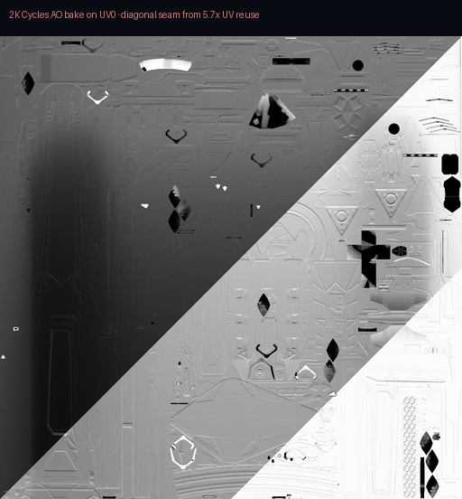
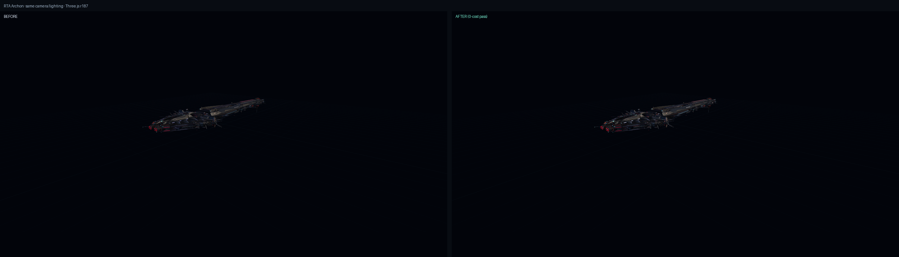
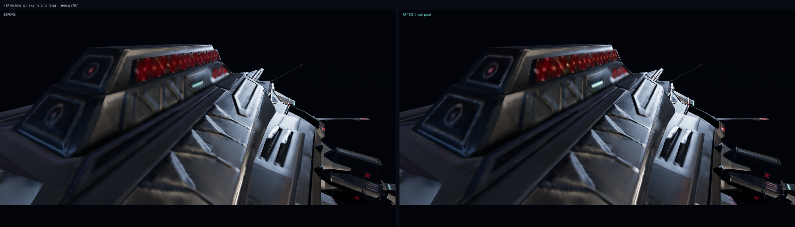
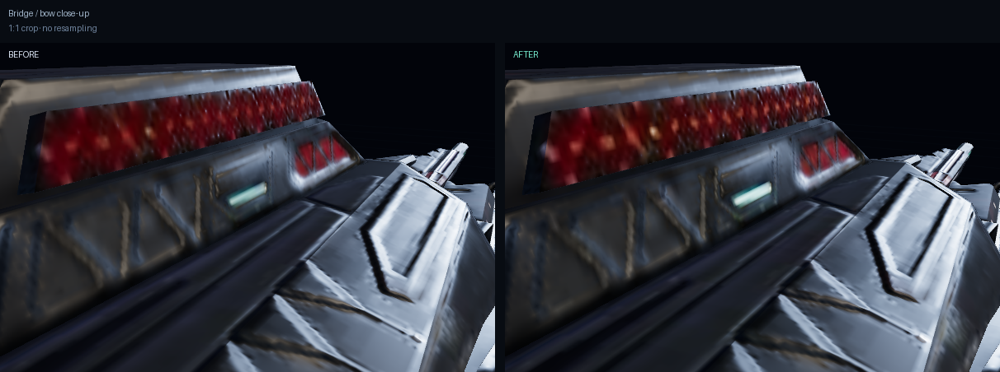
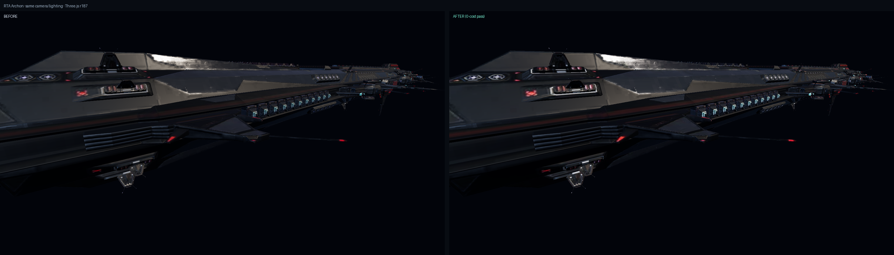
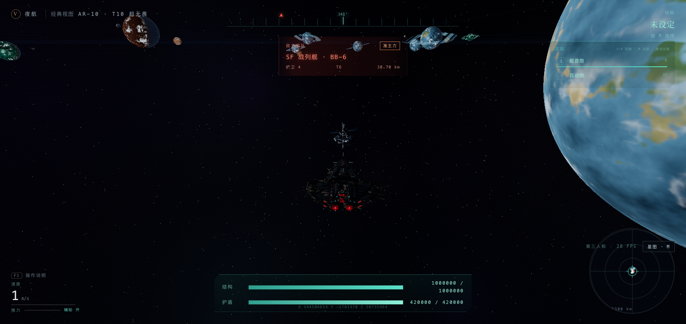
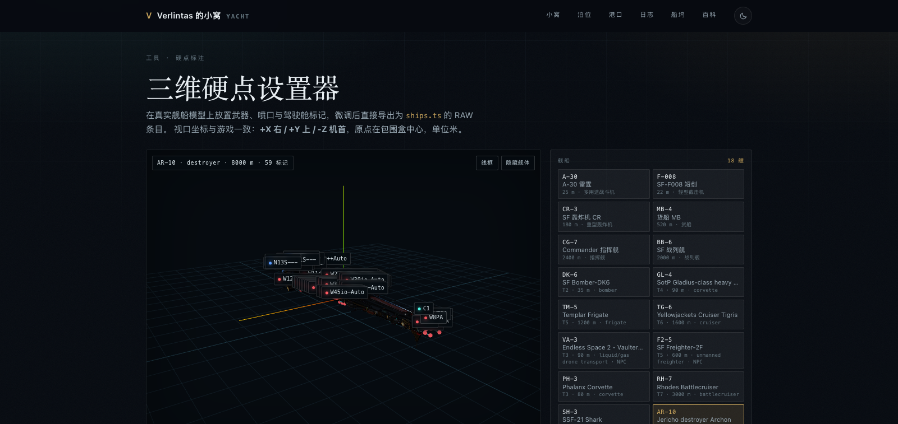
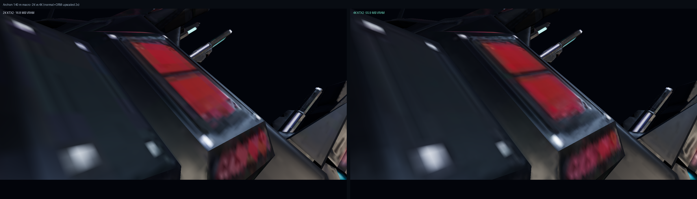

# Archon 贴图质量 pass（AR-10 / RTA Archon）

**日期：** 2026-11-16  
**工作树：** `/Users/apple/.local/share/opencode/worktree/e0f2de/archon-textures`  
**模型：** `public/models/candidates/rta_archon.glb`  
**状态：** 已提交到 worktree，**未合并**。主仓库未修改。

---

## 0. 结论先行

**0-cost pass 已完成并作为默认 GLB 提交。** 这次改动不是“把 2K 放大到 4K”，而是把这张资产本来缺失/错误的材质响应补齐：

1. **ORM**：R=AO/腔体、G=原始 roughness、B=重新 author 的金属度；`occlusionTexture` 与 `metallicRoughnessTexture` 指向**同一个 texture index**（否则 Three.js 会把 ORM 上传两次，白多 22MB VRAM）。
2. **自发光**：原有红色灯带 ×2.4，并从 albedo 提取青色窗灯；运行时 `emissiveIntensity=0.8`。
3. **albedo ×1.5**（轻微 unsharp）：只提升可读性，不产生新细节；仍是很暗的船（mean 15.24/255）。
4. **MikkTSpace 切线**：手写解包 + `mikktspace`，因为 glTF-Transform 4.5.1 的 `unweld()` 会破坏这张资产的归一化整数网格（详见 §3）。
5. **anisotropy 8 → 16**，`aoMapIntensity = 1`。
6. **几何/节点变换完全不变**：39,870 tris、节点 scale 209.338671、世界 bbox 165.761 × 53.103 × 418.677 全部保留；硬点/喷口/驾驶舱坐标不需要改。

**视觉结果（同一相机/光照，1:1 crop）：**

| 区域 | 平均亮度变化 | 边缘对比度变化 |
|---|---:|---:|
| 舰桥/舰首近景（约 600 m） | −0.6/255 | **+3.4%** |
| 舰体中段侧面（约 1.5 km） | +0.3/255 | **+13.7%** |

亮度基本不变，但 AO/金属/自发光让凹槽、面板线、窗灯更可读。没有 AI 放大、没有 hallucination。

**VRAM：** 4 张 2K 纹理仍是 **≈89.5 MB**（RGBA8 + mips，decimal），**没有增加贴图 VRAM**；顶点缓冲 +0.84 MB。KTX2 可选方案能把纹理 VRAM 降到 **≈16.8 MB**，但需要 KTX2Loader，本次没有接入默认游戏/setup。

**4K 结论：不值得作为默认。** 140 m macro 下 2K 与 4K 几乎不可区分；4K 只升了 normal+ORM（源就是 2K），下载 23.95 MB、VRAM 55.9 MB，而 2K KTX2 是 8.55 MB / 16.8 MB。只有 <50 m hero/座舱截图，或者未来拿到真正 4K 源，才考虑。

---

## 1. 原始资产体检（本机实测）

| 项目 | 值 |
|---|---:|
| 原始 GLB | 1,550,756 B（1.48 MiB / 1.55 MB） |
| 三角面 | 39,870 |
| 顶点 | 70,096（render vertices 119,610） |
| 材质 | 1 个：`rta_archon_hull` |
| 贴图 | baseColor / normal / metallicRoughness / emissive，均 2048² WebP |
| 扩展 | `EXT_meshopt_compression`, `EXT_texture_webp`, `KHR_materials_emissive_strength`, `KHR_mesh_quantization` |
| 切线 | **无 TANGENT** |
| occlusionTexture | **无**（ORM 的 R 通道完全没用） |
| 节点 | `rta_archon`，translation `[0, -2.314789, 15.661323]`，scale `209.338671` |
| 世界 bbox | 165.761 × 53.103 × 418.677（游戏内按 Z 轴缩放到 8,000 m） |

贴图内容（原始）：

| 贴图 | 关键统计 |
|---|---|
| albedo | 中位亮度 3.9/255，p90=34，75% 像素 <8/255；近黑 |
| normal | mean≈(126,126,251)，std≈14；有细节但偏软 |
| ORM | R 中位 254（AO≈1.0）、G 中位 127（roughness≈0.5）、B 中位 1（metal≈0.004） |
| emissive | 中位 0，仅 1.5% >32/255；红色灯带存在，青色窗灯没有 author |

UV/几何：

- UV bounds U −1..1、V 0..1，sampler repeat；左半镜像/复用。
- UV area sum **5.56**，0–1 tile 覆盖率 **97.3%**，平均复用 **≈5.7×**。
- 网格有 **15,969 个 loose parts**；这是后面 AO bake 不可用的根因。
- 每表面 texel density ≈12.6 texels/m（2K）；gameplay 10 km 下 2K 已经严重 oversampled。

---

## 2. 0-cost pass 具体改动

| 项 | 原始 | 现在 |
|---|---|---|
| 运行时 anisotropy | 8 | **16**（`src/game/ship.ts`） |
| aoMapIntensity | 未设置 | **1** |
| occlusionTexture | 无 | 与 ORM 同一 texture index（index 3） |
| metallicFactor / roughnessFactor | 默认 1 / 1 | 显式 1 / 1（由贴图控制） |
| ORM R（AO） | 254 平 | 中位 **215**，p1 169，p99 255；腔体+低频 bake |
| ORM G（roughness） | 中位 127 | **保持原始 G 不变**（本来 author 是对的） |
| ORM B（metal） | 中位 1 | 中位 **39**，p99 181；黑/暗部≈0.04–0.18，灰面板≈0.4–0.71，红/青涂装≈0.1 以下 |
| emissive | max 129，1.5% >32 | max 255，**1.57% >16**，0.34% >64；红带 ×2.4 + 青色窗灯 |
| albedo | mean 9.9/255 | **mean 15.24/255**（×1.5 + 0.15 unsharp；仍近黑） |
| normal | 原始 WebP | **字节完全不变**；只加 MikkTSpace TANGENT |
| 顶点 | 70,096 | 119,610（unindexed；render vertices 与原始相同） |
| 几何 | 39,870 tris | **39,870 tris，位置/三角形/法线验证通过** |

### 2.1 为什么 ORM 只改 R/B，不改 G

原始 roughness G 中位 127、p1 44、p99 162，已经有合理变化；把它整体压亮/压暗只会改变已 author 的高光。第一次尝试里把 G ×0.94 并加强暗部 roughness，结果在近景出现大面积高光条纹（后来定位到其实是 glTF-Transform `unweld()` 破坏法线，不是 G；但结论仍是：**不要无理由改 G**）。最终 G 与原始逐像素相同。

### 2.2 自发光

- 原有红色灯带是 author 过的，直接 ×2.4（linear 空间）。
- 青色/蓝色窗灯从 albedo 提取：`B > R×1.35 && G > R×1.2 && max>0.10`，再 ×2.2；加一点中性白高光。
- 保留 `KHR_materials_emissive_strength = 1.2`；运行时 `emissiveIntensity=0.8`，有效约 0.96。
- 没有把整张黑图 AI 放大，也没有给灰色 hull 加假灯。

### 2.3 运行时

`src/game/ship.ts` 只改了两行：

```ts
if ('aoMapIntensity' in material) material.aoMapIntensity = 1;
// ...
texture.anisotropy = 16;
```

`metalness` 的全局 clamp（`Math.min(..., 0.7)`）保留，避免影响其他候选舰。Archon 的 metal map p99=0.71，实际有效 p99≈0.50；这是有意的保守值，避免全船变成 chrome。

---

## 3. MikkTSpace 的坑（重要，已绕过）

**不要对这张资产直接用 `npx @gltf-transform/cli tangents` 或 `functions.tangents()`。**  
glTF-Transform 4.5.1 的 `unweld()` 对这张资产的 `KHR_mesh_quantization` 网格（normalized int16 POSITION + normalized int8 NORMAL，interleaved bufferView）处理错误：

- 三角形索引被重排/错配；
- 同一位置的法线不再对应原法线；
- 渲染表现为舰桥左侧面板出现亮蓝白竖条、整船高光异常。

我做了对照验证：

- 用 `unweld()` 后的 GLB，三角形 key 保留率 **0/39,708**，法线 dot 到原始值 worst **−1.0**。
- 用 `unweld()+tangents()+weld()` 后，三角形位置能恢复，但法线仍大面积错误（worst dot 0.994 是后来手写版本；错误版本 mean 0.14）。

最终 `scripts/archon-textures/build_glb_mt.mjs` 的做法：

1. 直接读 index buffer；
2. 按三角形手动展开顶点（unindexed）；
3. POSITION `/32767`、NORMAL `/127` 反归一化，法线重新归一化；
4. 对**精确的原始三角形**调用 `mikktspace`；
5. tangent.w 取反（glTF 约定）；
6. 写 unindexed 的 POSITION/NORMAL/TEXCOORD_0/TANGENT；
7. **不再 weld**（MikkTSpace 要求 unindexed）。

验证结果：

```text
triangles 39870 39870
vertices 70096 119610
TANGENT false -> true
indices true -> false
unique positions preserved 25310 / 25310 missing 0
triangle keys preserved 39814 / 39814 missing 0
  (1e-4 local precision ≈ 0.02 world units; bbox is exact)
normal dot to source: worst 0.99400 mean 1.00028 samples 70096
local bbox [-0.3959166, -0.1268349, -1] [0.3959166, 0.1268349, 1]
world size [165.761314, 53.102911, 418.677342]
```

节点 translation/scale 与原始**逐位相同**。硬点/喷口/驾驶舱是 `ships.ts` / `hardpoint-data.ts` 的外部坐标，不依赖 GLB 节点名；模型 raw Z 长度仍是 418.677，游戏按 `8000 / rawLength` 缩放，和修改前一致。

### 3.1 另一个坑：occlusion 与 ORM 的 texture index

glTF-Transform 写文件时会给 occlusion 和 metallicRoughness 各写一个 texture entry（即使 source 相同）。Three.js 的 texture cache 按 glTF texture index 建 key，两个 index 会让 ORM 上传两次 → 2K 下多 22.37 MB VRAM。

`scripts/archon-textures/dedupe_occlusion.py` 会：

- 把 `occlusionTexture.index` 指向 `metallicRoughnessTexture.index`；
- 删除未引用的 texture entry；
- 重映射所有 material texture index。

最终 GLB 是 4 个 texture entry，`aoShared true`（Three.js 里 `aoMap === roughnessMap`）。

---

## 4. AO bake 的诚实结论（不可用 per-surface AO）

我确实做了真 AO bake，但**这张资产的 UV0 不能承载真 AO**：

- Cycles 2K、64 samples、distance=0.5 local（≈9.5 m 游戏尺度），约 **19.4 s**。
- UV0 覆盖率 97.3%，UV area sum 5.56，每个纹素被 **2–27 个面**共享（1024 raster 统计），网格 15,969 个 loose parts。
- bake 结果出现明显对角线 seam/渐变：多个面抢同一 texel，最后一个面覆盖前一个；这不是可用的 per-surface AO。
- 试过 Smart UV Project 生成唯一 UV 再 bake：16k 个 loose parts 变成 16k 个小岛，2K 下大量岛只有 1–2 texel，AO 呈噪点，不可用。



最终方案：

- **低权重几何 bake**（`0.58 + 0.42*ao`，再 blur 2 px）作为大尺度接触阴影；
- 乘以 **normal map cavity**（normal 梯度，blur 1.4，`1 − 0.48*edge`）；
- 两者合成 ORM 的 R 通道，整体范围约 0.54–1.0。

这是“AO-like”，不是可验证的 per-surface AO。要真 AO，需要：

1. 加 UV1 + 单独 1K/2K AO 贴图（+1.4 MB KTX2 / +5.6 MB RGBA8，且 `aoMap` 用 UV1）；或
2. re-UV / trim sheet，把 16k loose parts 合并成可管理的 island。

这两项都不是 0-cost，本次没有做。

---

## 5. 渲染对比

渲染工具：Three.js r187、ACESFilmic、exposure 1.0、同样的 env/sun/fill 和相机；before/after 完全同一 rig。`gameplay` 是约 10 km 第三人称，`closeup` 是舰桥/舰首约 600 m，`hull` 是中段侧面约 1.5 km。









量化（同一 crop，灰度）：

- closeup：mean 55.96 → 55.36，std 54.87 → 54.84，Laplacian edge **+3.4%**。
- hull：mean 23.21 → 23.48，std 25.57 → 26.45，Laplacian edge **+13.7%**。

也就是说：**亮度基本不变，局部对比/边缘细节增加**；不是靠把船整体提亮或加 bloom。红色灯带在 after 里更干净（没有错误高光条纹），青色窗灯更亮。

### 5.1 游戏内 / setup 验证

- 游戏：`http://localhost:4332/yacht/?ship=rta_archon` 加载成功，HUD 显示 `AR-10 · T10 超无畏`；SwiftShader 下 21–28 FPS（软件渲染，不代表真机）。
- setup：`/yacht/setup/` 选择 AR-10 后显示 `AR-10 · destroyer · 8000 m · 59 标记`，模型与 C1/喷口标记可见。
- 没有 console error；`gltf-transform inspect` 显示 `EXT_meshopt_compression / EXT_texture_webp / KHR_materials_emissive_strength / KHR_mesh_quantization` 正确，TANGENT 存在，occlusion 与 MR 共用 texture index。





---

## 6. 体积 / VRAM

纹理 VRAM 按 2048² RGBA8 + mips ≈ **22.37 MB/张**（decimal；21.33 MiB），4 张共 **≈89.5 MB**。顶点缓冲原始 1.67 MB → 现在 **2.51 MB**（unindexed + TANGENT），+0.84 MB。

| 方案 | GLB 下载 | 纹理 VRAM | 估算总 VRAM | 说明 |
|---|---:|---:|---:|---|
| 原始 2K WebP | 1.55 MB | 89.5 MB | ≈90.3 MB | 无 AO/无 TANGENT |
| **本次 2K WebP（默认）** | **4.67 MB** | **89.5 MB** | **≈90.3 MB** | AO/ORM/metal/emissive/TANGENT |
| 2K KTX2 mixed | 8.55 MB | **16.8 MB** | ≈17.6 MB | ETC1S 颜色 + UASTC normal/ORM；需 KTX2Loader |
| 4K KTX2 | 23.95 MB | 55.9 MB | ≈56.7 MB | 4K normal+ORM，2K albedo/emissive；需 KTX2Loader |
| 4K WebP | 未构建 | ≈358 MB | ≈359 MB | 不适合 web 游戏 |

> KTX2 文件大小是 meshopt + dedupe 后的最终值；`gpuSize` 是 glTF-Transform 按 BC7/ASTC 4×4 估算，实际取决于 GPU 选择的 transcode 格式。  
> 2K KTX2 的 8.55 MB 下载 > 4.67 MB WebP，但 VRAM 从 89.5 MB 降到 16.8 MB；这是“下载换显存”的取舍。

**为什么默认不直接上 KTX2：** 游戏 `ship.ts` 和 setup 的 `hardpoint-editor.ts` 目前都只配置了 `MeshoptDecoder`，没有 `KTX2Loader` + `public/basis/` transcoder。直接替换会让这两个入口加载失败。本次目标是先交付能立刻加载的 0-cost 质量 pass；KTX2 是下一步的独立改动。

---

## 7. 4K 值得吗？

**不值得作为默认。**



- 测试：4K normal+ORM 由 2K Lanczos 2× + renormalize；albedo/emissive 保持 2K。140 m macro 下，2K 与 4K 的差别只在红色窗框边缘的 1–2 px 级细节，几乎不可见。
- 源就是 2K；Lanczos 不产生新细节。4K 只是减少放大时的模糊，不解决“unique 纹素被 5.7× 复用”的问题。
- 成本：4K KTX2 23.95 MB 下载、55.9 MB VRAM；2K KTX2 8.55 MB、16.8 MB。4K 的下载是 2.8×，VRAM 是 3.3×。
- 只有两种情况值得：<50 m 的 hero/座舱截图；或者拿到真正 4K/8K master 重新 author。即便如此，也不建议盲目升 4K albedo——它近黑，收益最低。

**长期正确解仍然是**：re-UV / 2K trim sheet + decal atlas / 多材质。2K trim sheet 在 4×4 平铺下局部密度可超过 4K unique atlas，显存仍是 2K。

---

## 8. 复现 / 文件

### 复现

```bash
# 1. 解包原始 GLB（原始文件可从主仓库或 git history 取）
scripts/archon-textures/prepare.sh /path/to/original/rta_archon.glb

# 2. 0-cost pass（AO bake + pack + 手动 MikkTSpace + meshopt + dedupe + verify）
scripts/archon-textures/build.sh

# 3. 可选：KTX2 2K/4K 对比
scripts/archon-textures/ktx2.sh

# 4. 渲染 before/after
python3 -m http.server 8137 --bind 127.0.0.1
scripts/archon-textures/render_screenshots.sh
```

脚本细节和已知坑见 `scripts/archon-textures/README.md`。

### 改动文件

- `public/models/candidates/rta_archon.glb` — 优化后的 GLB（4,665,556 B，sha256 `012015960178427bb4c841bff348a3aaaac6bf07b0423894810786fe14ee5adf`）
- `src/game/ship.ts` — anisotropy 16、`aoMapIntensity=1`
- `docs/ARCHON-TEXTURE-PASS.md` — 本报告
- `docs/archon-textures/` — 对比渲染
- `scripts/archon-textures/` — 可复现管线
- `work/` — 中间文件，已 gitignore，不提交

### 建议

1. **先合这个 0-cost pass**：质量/可读性提升，VRAM 不增加，加载路径不变。
2. 如果显存成为问题，再做 **KTX2Loader + 2K KTX2**（16.8 MB VRAM），并给 setup 也加 loader。
3. 如果 Archon 要做 <50 m hero 或可登舰，做 **re-UV / 2K trim sheet**；不要用 4K unique atlas 硬撑。
4. 如果要“真正的 AO”，加 UV1 + AO 贴图，或直接 re-UV；当前 ORM 的 R 是 AO-like，不是 per-surface AO。
5. 如果觉得 albedo ×1.5 改变了美术方向，把 `scripts/archon-textures/pack_textures.py` 里的 `albedo * 1.5` 改成 `* 1.25` 或 `* 1.0` 重新跑即可；ORM/自发光/TANGENT 不受影响。
