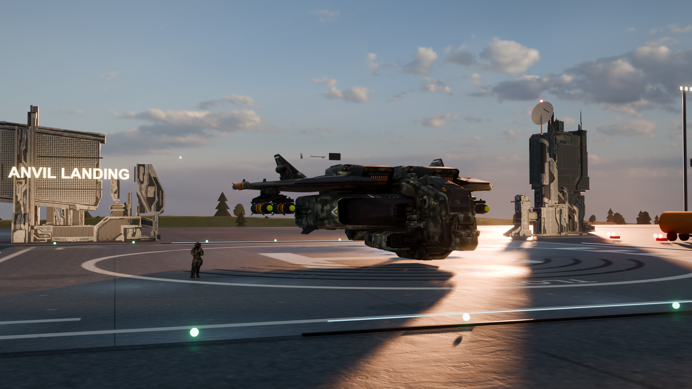
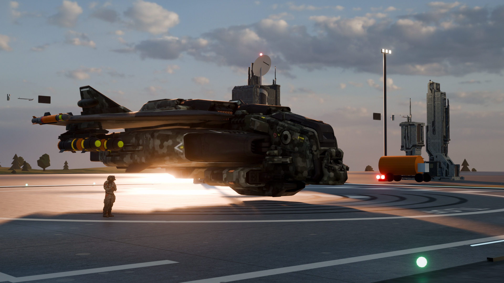
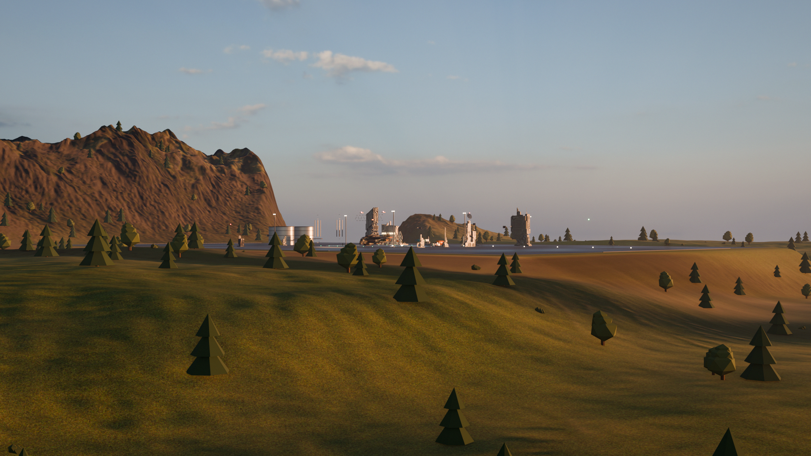
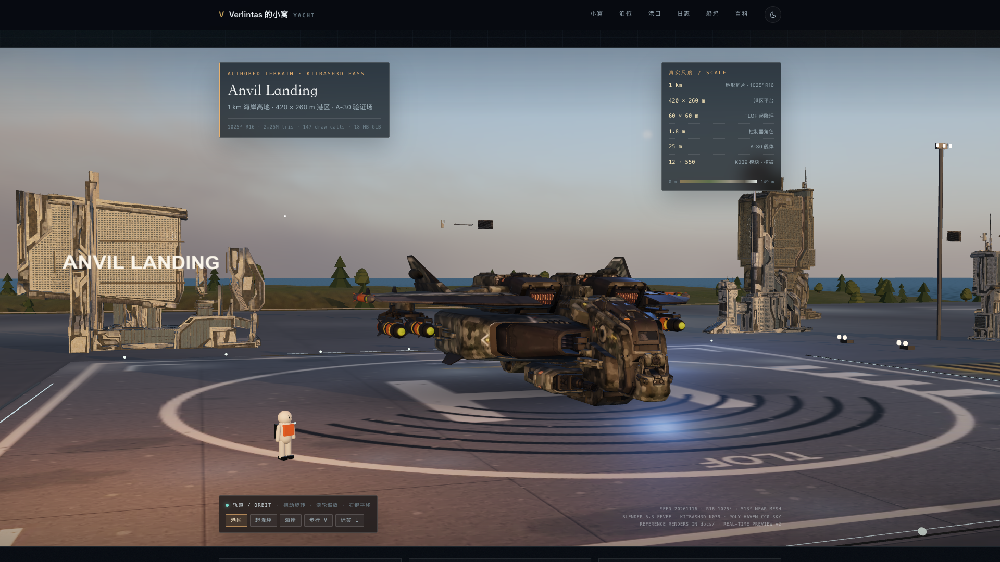
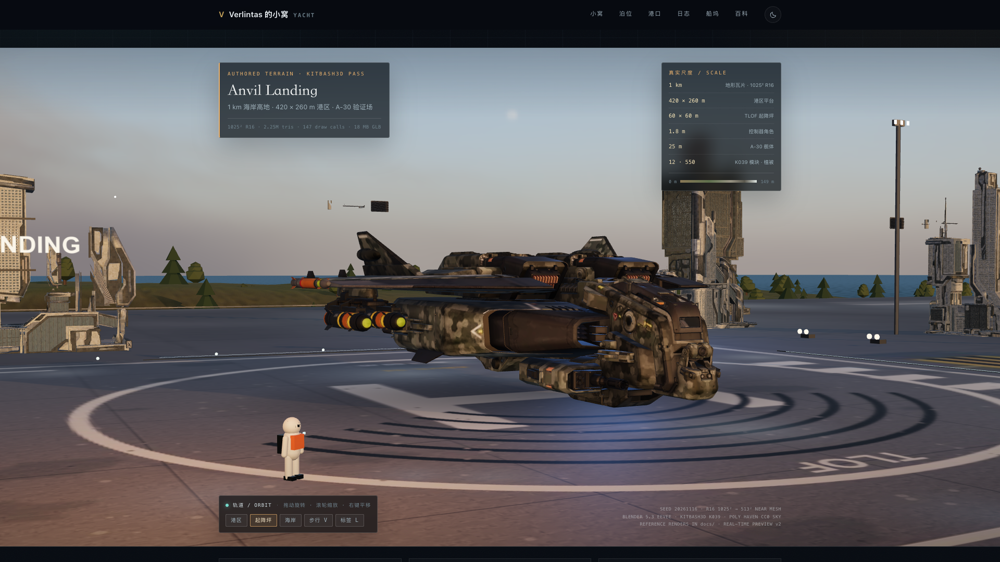
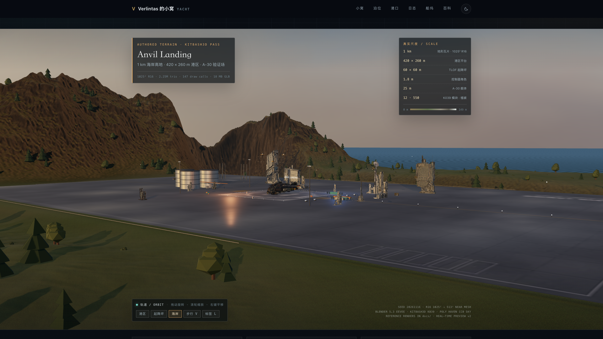
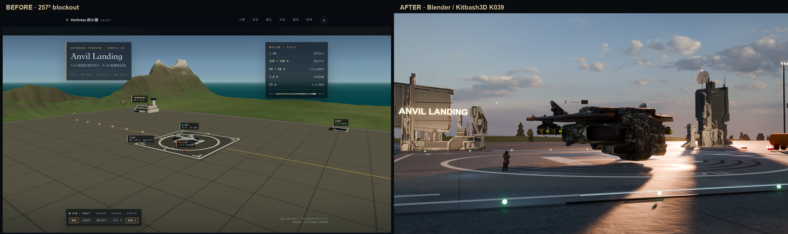

# Anvil Landing · v2 — Blender / Kitbash3D port sample

Anvil Landing is a coastal port sample for the yacht game. v2 replaces the
low-poly blockout with a Blender-authored district built from the owner's
Kitbash3D Sci-Fi Industrial kit, a 25 m A-30, a posed high-quality humanoid,
and a 1025 × 1025 R16 terrain tile. The page loads an optimized real-time
version of the same district in Three.js.

- Page: `/yacht/terrain-sample/` (`src/pages/terrain-sample.astro`)
- Real-time code: `src/scripts/terrain-sample.ts`
- Terrain generator: `tools/terrain/generate_sample.py`
- Blender scene builder: `tools/blender/build_scene.py`
- GLB export / optimization: `tools/blender/export_glb.py`
- Real-time GLB: `public/terrain-sample/models/anvil-port.glb`
- Heightfield + maps: `public/terrain-sample/`
- Asset manifest: [`../assets-manifest.json`](../assets-manifest.json)

## Screenshots

### Blender EEVEE reference renders (1920 × 1080, 128 samples)



*Port wide: Kitbash3D hangar and terminal, 60 m TLOF, A-30, fuel truck,
radar, 1.8 m controller.*



*Pad close: A-30 on the pad, wet apron, terminal, fuel truck, controller.*



*Terrain vista: 1025² R16 coast, ridge, bay, 550 procedural plants, port apron.*

### Real-time Three.js preview (headless Chrome, 1920 × 1080)







The real-time screenshots were captured with headless Chrome and SwiftShader;
they verify that the exported GLB, terrain splat map, water, sky, orbit and
walk modes all load. They are not a GPU frame-rate benchmark. The Blender
renders are the visual quality target.

### Before / after



The left panel is the previous 257² vertex-colour blockout
(`terrain-sample-before.png`); the right panel is the v2 Blender render.

## What is new

| Area | v1 | v2 |
| --- | --- | --- |
| Port | procedural boxes / canvas textures | 12 placed Kitbash3D K039 modules + custom props |
| Ship | procedural silhouette | actual `thunderbolt.glb`, 25 m, baked into the port GLB |
| Character | orange capsule | two posed Modelshop Greebles characters in the Blender renders; lightweight 1.8 m stand-in in the real-time preview |
| Terrain | 257² vertex-coloured | 1025² R16 + normal/AO/splat/shore maps; 513² near mesh; PBR grass/dirt/rock/sand |
| Coast | flat sea plane | carved bay/coast, foam-aware water shader in Three.js |
| Lighting | basic sun | CC0 sunset HDRI, 4096 shadows in Three.js, EEVEE reference renders |
| Vegetation | none | 550 conifers / broadleaf trees / shrubs |
| UI | scale sample | compact overlay, before/after, reference gallery, orbit + walk |

## Scale stack

| Feature | Value |
| --- | --- |
| Terrain tile | 1024 m × 1024 m, 1025 × 1025 samples (1 m spacing) |
| Height encoding | R16 little-endian, 256 m full scale |
| Port apron | 420 × 260 m, flattened at 28 m |
| TLOF | 60 × 60 m painted pad |
| A-30 | 25 m length |
| Controller | 1.8 m high |
| Port modules | 12 placed K039 modules + custom gantry/tanks/containers/lights |
| Vegetation | 550 procedural plants |
| Source district | ~150 × 120 m cluster inside the 420 × 260 m apron |

## Regenerate

Terrain (Python 3.10+, NumPy, Pillow):

```sh
python3 tools/terrain/generate_sample.py \
  --droplets 70000 \
  --preview /tmp/anvil-heightmap.png
```

Blender scene (requires the local, owner-provided Kitbash3D K039 FBX and the
Modelshop Greebles posed-character blend at the paths recorded in
`assets-manifest.json`):

```sh
Blender -b --python tools/blender/build_scene.py -- --stage build
Blender -b /tmp/anvil_port.blend \
  --python tools/blender/build_scene.py \
  -- --stage render --shots PortWide PadClose Vista \
  --res 1920x1080 --samples 128
```

Real-time GLB:

```sh
Blender -b /tmp/anvil_port.blend --python tools/blender/export_glb.py
npx @gltf-transform/cli optimize \
  public/terrain-sample/models/anvil-port.glb \
  /tmp/anvil-port-opt.glb \
  --compress meshopt --simplify false \
  --texture-compress webp --texture-size 1024 --palette false
cp /tmp/anvil-port-opt.glb public/terrain-sample/models/anvil-port.glb
```

The committed GLB is the optimized result (17.6 MB). The source FBX/BLEND
files are not committed.

## Runtime / verification

```sh
npm run check
npm run build
npm run preview -- --port 4329
# http://localhost:4329/yacht/terrain-sample/
```

Controls: drag to orbit, wheel to zoom, right-drag to pan; `V` walk mode
(WASD, Shift sprint, mouse look, Esc release); `L` scale labels; `R` reset to
the port view. On-screen presets: 港区 / 起降坪 / 海岸.

## Performance

| Measurement | Value |
| --- | --- |
| Blender source geometry | ~5.0M Kitbash triangles + 513² terrain (~0.52M) + characters/props |
| Reference render | EEVEE, 1920 × 1080, 128 samples, ~25–40 s per frame on this Mac |
| Exported port GLB | ~867k triangles after decimation, 17.6 MB (Meshopt + WebP) |
| Real-time total | 2.25M render triangles including shadow pass, 147 draw calls |
| Runtime textures | 1K building maps, 2K port surfaces, 1025² terrain maps, 2K HDR |
| Budget | 2–4M triangles, <200 draw calls, <300 MB VRAM target |
| 60 fps | Not measured on a hardware GPU in this pass; headless verification used SwiftShader |

## Known limitations

- The real-time preview uses a lightweight 1.8 m procedural controller
  stand-in. The two high-quality posed humanoids appear in the Blender
  reference renders, not in the exported real-time GLB.
- The port GLB is a decimated/compressed derivative of the 5M-triangle Blender
  scene. Close-up detail is softer than the reference renders.
- Terrain is a single 513² near mesh on a 1 km tile. There is no
  LOD/streaming system, collision, navmesh, or walk-mode building collision.
- The real-time sky/HDRI rotation and sun/fill levels are approximate to the
  Blender lighting. The Blender EEVEE renders are the quality target.
- The district is a ~150 × 120 m cluster inside the 420 × 260 m apron, not a
  full 600 × 600 m city. The scope was deliberately kept to the hero port.
- Purchased Kitbash3D and Modelshop source archives are not redistributed;
  only the optimized derivative GLB, generated textures, and renders are
  committed. See `assets-manifest.json`.
