# 鱼雷 / 导弹与爆炸 VFX 改造

**日期：** 2026-11-16  
**Worktree：** `/Users/apple/.local/share/opencode/worktree/e0f2de/vfx-torpedo`  
**范围：** AR-10 Archon A 级鱼雷、玩家/NPC 通用鱼雷、全局爆炸、T10 终末爆炸。  
**未合并 main。**

---

## 1. 结论

这一轮把鱼雷从「一个圆柱 Mesh + 一个 Sprite 光晕」改成了独立的 InstancedMesh 导弹批次，并加上分层尾迹、引擎火花/烟、轻微螺旋和终端增推；爆炸则重做为「连续火球底光 + 大量冷却火粒子 + 相机朝向等离子冲击环 + Instanced 残骸 + 预置点光源 + 沿舰体轴线的级联殉爆」。

关键约束保持不变：

- A 级鱼雷 **3,600 m/s** 不变。
- **5–15 秒**动态装填不变。
- T10 模块殉爆仍是随机时间/随机位置，不再按 W1→W45 排队爆炸。
- 终末爆炸比普通模块爆炸大一个数量级。

---

## 2. 鱼雷 / 导弹

### 2.1 弹体

新文件：`src/game/torpedo-vfx.ts`

- 弹体由程序化几何合并而成：主弹体、卵形鼻锥、尾段、4 片尾翼、前部小舵面、侧向加强条、重型弹额外两个助推器和背脊。
- 两套几何：
  - **重型 / A 级**：约 138 m 长、30 m 直径，4 片大尾翼 + 双助推器。
  - **轻型 / 小型鱼雷**：约 17 m 长、3.8 m 直径，4 片小尾翼。
- 所有鱼雷共用：
  - 2 份舰体几何；
  - 2 份舰体材质；
  - 2 份发光件材质；
  - 2 份外焰材质 + 2 份内焰材质；
  - 2 份引擎辉光材质。
- 重型/轻型各有一组 InstancedMesh：舰体、发光件、外焰、内焰、引擎辉光。**整批 220 枚鱼雷的弹体+尾焰+辉光只需要 10 个 draw call**（不含尾迹丝带）。

### 2.2 尾迹

`TrailRibbon` 是所有鱼雷共用的世界空间丝带：

- 260 个槽位 × 20 段，单个 Mesh、单 draw call。
- 片元里做「窄亮核 + 宽柔光」两层，中心不是生硬圆柱。
- 当视线与尾迹接近平行时自动淡出丝带，避免退化成两条交叉边线；近距离仍由粒子层补足。
- 粒子层：
  - `trailParticles`：白热核、外层橙色辉光、引擎火花，共 4,800 容量；
  - `trailSmoke`：暖灰/棕色烟，1,600 容量；
  - 全部固定容量、一次分配，不每帧 new。

### 2.3 螺旋与终端增推

- 弹体沿飞行方向有轻微横向/纵向偏移和滚转；尾迹采样点跟着摆动，形成轻微螺旋。
- 终端阶段（距目标约 `speed × 1.6 + 600` 米，或剩余寿命 < 1.6 s）：
  - 外焰长度 ×1.9；
  - 引擎辉光 ×1.55；
  - 火花/粒子发射率 ×1.8；
  - **不修改实际速度**。
- 尾迹、弹体、辉光全部走 InstancedMesh/固定粒子场，不在热路径分配节点/材质。

### 2.4 命中可靠性

8 km 舰体的 BVH 三角面很稀疏，鱼雷可能从发动机口/结构缝穿过去。对长度 ≥ 500 m 的大舰增加了：

1. 细长胶囊兜底检测（仅鱼雷，且舰长 ≥ 500 m）；
2. 从兜底命中点向舰体中心发射一条 BVH 射线，把爆炸点吸附到真实船壳表面。

这样避免「视觉上穿过船体、没有伤害」，也避免爆炸出现在舰体内部被完全遮挡。

---

## 3. 爆炸

新文件：`src/game/explosion-vfx.ts`，共用纹理/粒子场在 `src/game/vfx-common.ts`。

### 3.1 火球

- **正常混合火球底光**：沿舰体轴线叠 5 个 normal-blend 火球 Sprite，提供连续橙色体积，不再只看到散点粒子。
- **加法混合火粒子**：2,600 枚终末火粒子 + 持续 2.4 秒、300/s 的热斑补充；颜色从白热核/橙色冷却到暗红。
- **火花/余烬**：2,600 容量，带寿命、阻力、旋转。
- **烟**：少量、低不透明度暖灰烟，只做体积层次，不再用浓烟盖住火球。
- 火球纹理改为不规则火焰条纹 + 湍流 alpha 边缘，不再是每个粒子一个完美圆点。

### 3.2 冲击波与等离子环

- 冲击波改为 **4 层相机朝向的椭圆等离子环**，共享噪声环纹理；半径、透明度、寿命分层。
- 环统一朝向/缓慢旋转，避免之前多个不同角度圆环叠成「原子模型」。
- 放弃原来的球壳 Fresnel 网格：在大尺度下球壳会变成厚玻璃气泡，视觉不可控，已移除。

### 3.3 残骸

- 6 个 InstancedMesh（3 种形状 × 冷/热材质），最多约 620 块。
- 冷/热材质、几何共享；每帧只更新实例矩阵。
- 终末爆炸残骸尺寸按舰长缩放，大块可达数百米；普通命中也有 26 块左右。

### 3.4 光照与级联殉爆

- 场景预置 6 盏 PointLight，避免动态增删灯光导致 shader 重编译。
- 终末爆炸沿舰体轴线安排 7 个延迟 0.18–2.0 s 的级联殉爆，并追加 2.35 s 的余烬爆炸。
- 级联殉爆通过 `onSecondary` 回调 main，触发音效/震屏/屏幕闪光。
- 死亡序列的模块爆炸仍使用随机 `at`，保留「不排排炸」的行为。

### 3.5 分级与终末

- 按 tier 使用不同颜色组：小型/中型/主力/无畏/终末。
- 终末 T10：
  - 主火球沿舰体轴线椭球分布；
  - 4 层冲击环 + 2 层等离子环；
  - 沿轴 7 次级联 + 余烬爆炸；
  - 约 100 块残骸、3,000+ 火粒子、300+ 火花；
  - 屏幕闪光在 main 中单独放大（`kind = 'final'`，衰减 0.95 s，范围 26 km）。

### 3.6 屏幕闪光

`src/game/main.ts` 的 `onExplosion` 现在接收第三个参数 `kind`：

- 普通爆炸仍按距离/尺寸计算闪光；
- `final` 使用更大的距离衰减、更高的闪光上限和更长的衰减时间，并把 `#impact-flash` 换成白/青/橙径向渐变。

---

## 4. 性能

### 4.1 结构优化

| 项目 | 改造前 | 改造后 |
|---|---|---|
| 每枚鱼雷弹体 | 1 Mesh（Cylinder） | InstancedMesh 共享几何/材质 |
| 每枚鱼雷光晕 | 1 Sprite + 独立 Material | 每批 1 个 InstancedMesh billboard |
| 尾迹 | 每枚鱼雷一个拉长圆柱 | 1 条全局丝带 + 2 个全局 Points |
| 爆炸火球 | 每爆 4 个 Sprite + 新 Material/几何 | 固定粒子场 + 20 个预分配火球 Sprite |
| 残骸 | 每块新几何/新材质 | 6 个 InstancedMesh |
| 灯光 | 每个爆炸新建 PointLight | 6 盏预置 PointLight 池 |
| 弹丸数组删除 | `splice` 搬移 | 交换删除 |

### 4.2 实测

测试页：`/yacht/vfx-torpedo-test/?scene=bench&hud=0`  
数据：`docs/vfx-torpedo/perf.json`

| 场景 | 活跃鱼雷 | `Combat.update` CPU | 场景 draw call | 后处理总 draw call | 三角形 |
|---|---:|---:|---:|---:|---:|
| bench：140 重 + 80 轻 | 220 | **0.36 ms/帧** | **14** | 28 | 352,080 |
| 鱼雷特写 | 1 | — | 38 | — | 11,552 |
| 14 发齐射 | 14 | — | 27 | — | 72,640 |
| 单发命中 | 命中后 0 | — | 47 | — | 50,152 |
| 终末死亡 18.45 s | 0 + 终末 VFX | — | 56 | — | 12,596 |
| 终末爆炸 0.70–1.15 s | 0 + 终末 VFX | — | 58–63 | — | 11.3–11.6k |

Bench 同时有：

- 220 个活跃尾迹槽位；
- 4,563 个活跃尾迹粒子；
- 1,600 个活跃尾迹烟粒子（容量上限）；
- 11 个鱼雷相关 draw call（10 个 InstancedMesh + 1 条丝带）。

> 说明：以上是 headless Chrome + SwiftShader 的 CPU/命令提交数据。`sceneRenderMs` 约 0.13–0.16 ms、`composerRenderMs` 在 0.22–4.9 ms 间波动（首帧/着色器编译/SwiftShader 调度），不代表真实 GPU FPS；真实帧率需要在硬件 GPU 上验收。

---

## 5. 截图

全部 43 张逐帧截图：`docs/vfx-torpedo/`  
逐帧时间/文件清单：`docs/vfx-torpedo/captures.json`

### 鱼雷特写

| 0.30 s | 0.82 s（终端增推） | 1.18 s（尾迹/烟） |
|---|---|---|
| 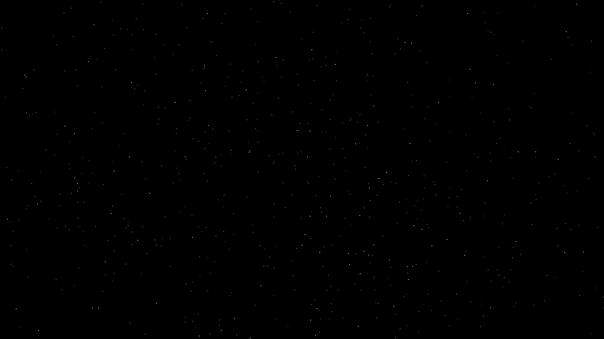 |  | 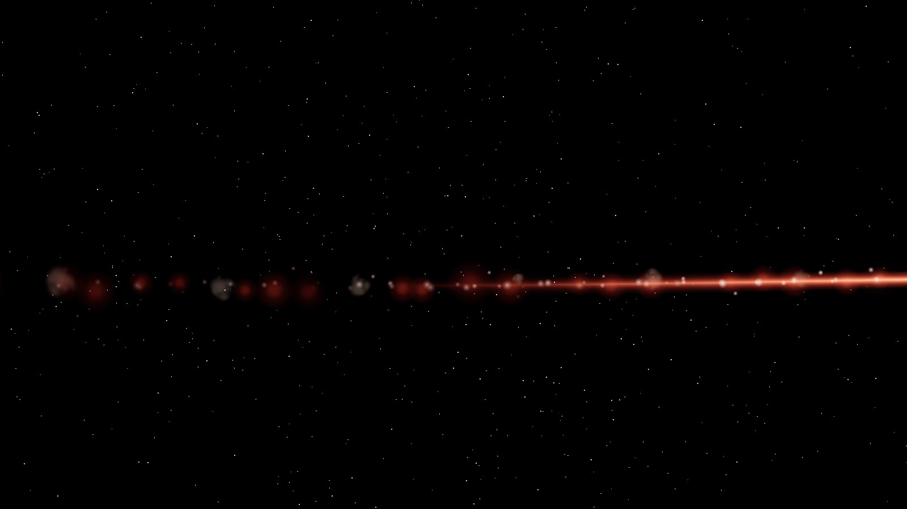 |

### 齐射

| 0.70 s | 1.20 s | 2.60 s |
|---|---|---|
| 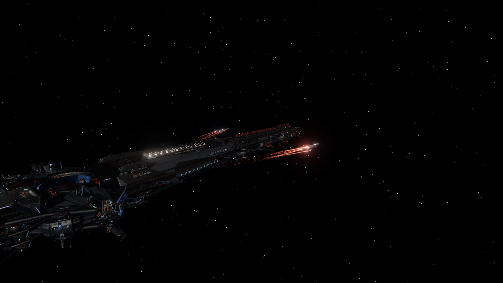 | 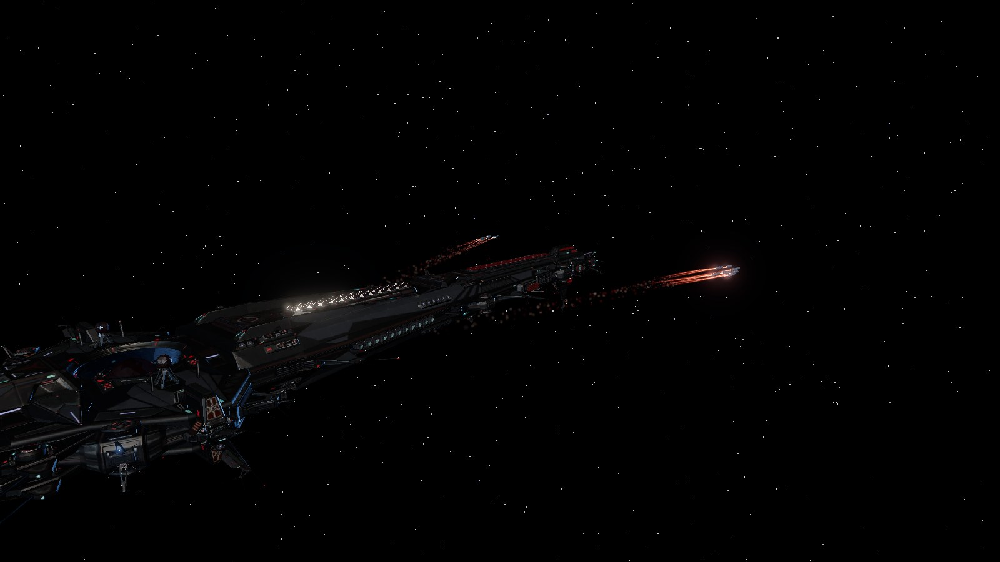 |  |

### 命中

| 3.11 s（命中前） | 3.35 s | 3.65 s |
|---|---|---|
| 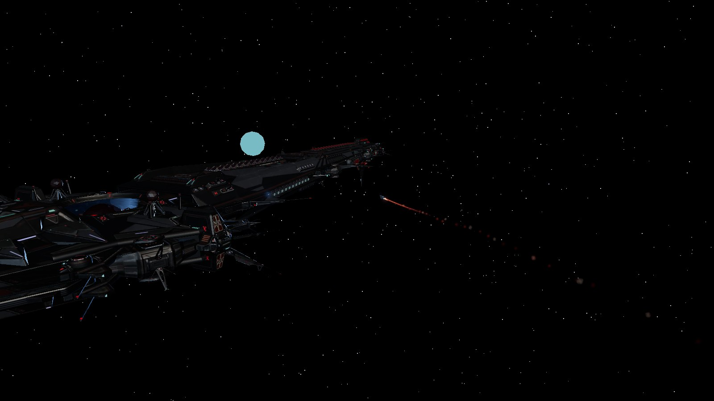 | 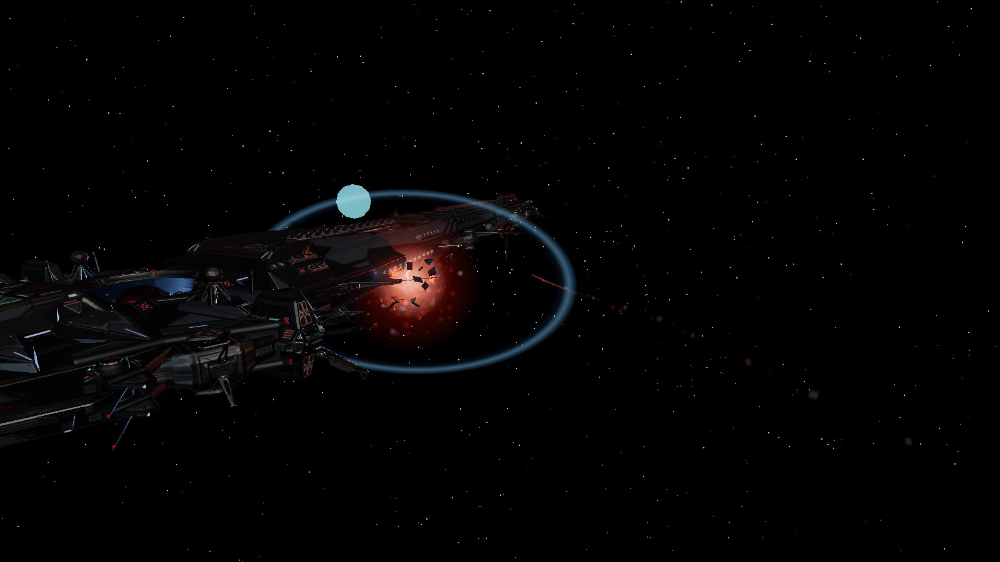 |  |

### 大舰死亡序列

| 9.50 s（随机模块殉爆） | 18.04 s（终末闪光） | 18.45 s（火球/残骸/冲击环） |
|---|---|---|
| 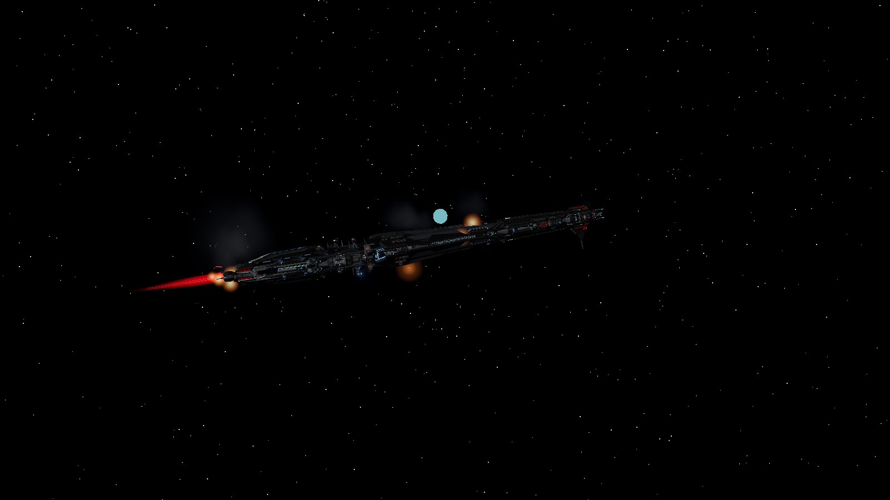 |  |  |

### 终末爆炸

| 0.10 s | 0.40 s | 1.15 s | 4.50 s |
|---|---|---|---|
| 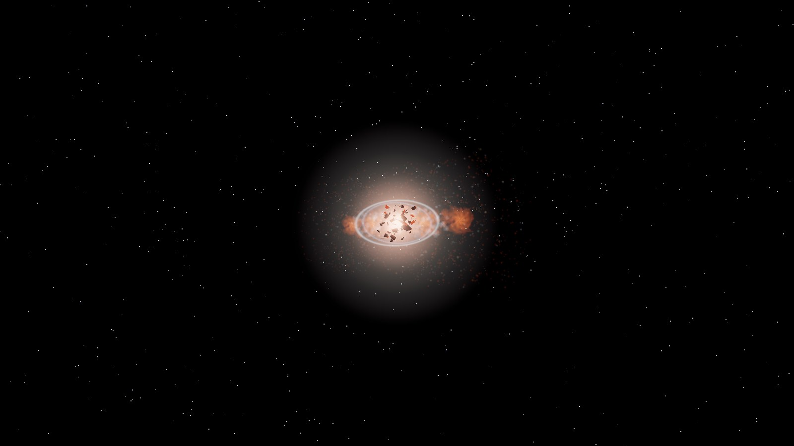 | 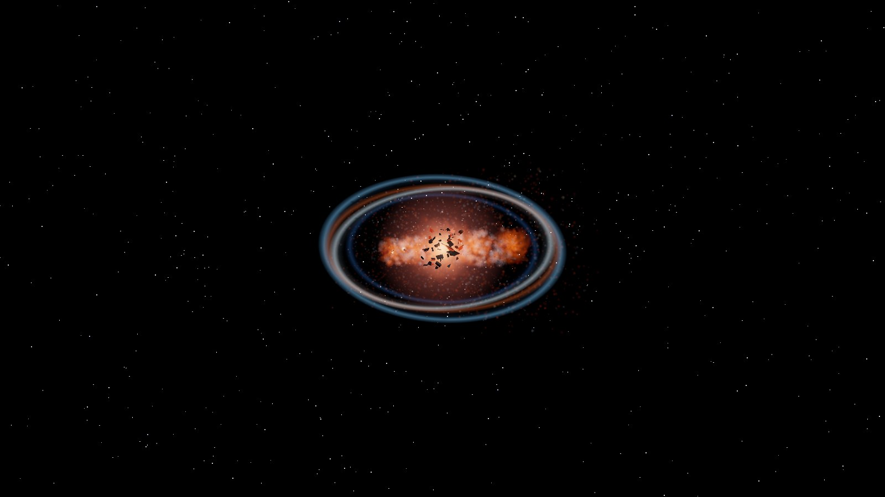 | 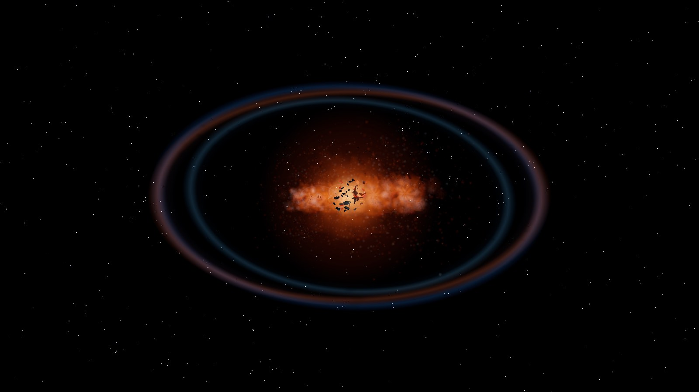 | 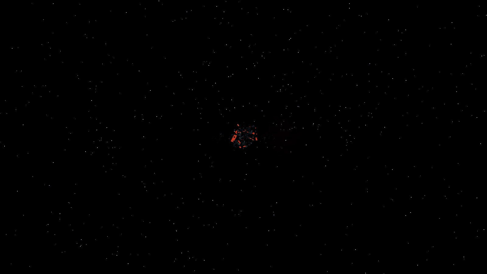 |

### 完整游戏启动验证

`docs/vfx-torpedo/game-boot.jpg` — headless Chrome 启动 `/yacht/`，无 console error。

---

## 6. 复现 / 测试

```sh
cd /Users/apple/.local/share/opencode/worktree/e0f2de/vfx-torpedo
npm install
npm run dev -- --port 4329
```

打开：

```text
http://localhost:4329/yacht/vfx-torpedo-test/?scene=torpedo&hud=0
http://localhost:4329/yacht/vfx-torpedo-test/?scene=volley&hud=0
http://localhost:4329/yacht/vfx-torpedo-test/?scene=impact&hud=0
http://localhost:4329/yacht/vfx-torpedo-test/?scene=death&hud=0
http://localhost:4329/yacht/vfx-torpedo-test/?scene=finale&hud=0
http://localhost:4329/yacht/vfx-torpedo-test/?scene=bench&hud=0
```

自动逐帧截图：

```sh
VFX_URL='http://localhost:4331/yacht/vfx-torpedo-test/' node scripts/vfx-capture.mjs
# 只跑单个场景：
VFX_SCENES=impact,finale VFX_URL='...' node scripts/vfx-capture.mjs
```

> `vfx-capture.mjs` 原生输出 PNG；仓库内的截图已用 Pillow 转成 JPG 控制体积。  
> 如需重新生成同体积的 JPG：`python3 -c "from PIL import Image; import pathlib; [Image.open(p).convert('RGB').save(p.with_suffix('.jpg'), quality=88, optimize=True) for p in pathlib.Path('docs/vfx-torpedo').glob('*.png')]"`。

检查/构建：

```sh
npm run check
npm run build
```

---

## 7. 已知限制

- **真实 GPU 帧率未测**：SwiftShader 只能说明 CPU 逻辑和 draw call 结构；30/60 FPS 需在硬件浏览器验收。
- **测试场景是合成场景**：星场 + Archon 模型，不等于完整游戏的光照/行星/后处理负载。完整游戏 `/yacht/` 已启动验证无 console error，但未做长时间实战。
- **冲击环是相机朝向 Sprite**，不是真实 3D 球壳。3D 球壳在大尺度下会出现厚玻璃气泡和多重同心圆，视觉/性能都不可控；因此选择椭圆等离子环。
- **端向尾迹会淡出**：视线与航向接近平行时，丝带几何退化，自动淡出，只保留粒子。斜侧视角最完整。
- **容量上限**：鱼雷实例 260/批，尾迹丝带 260 槽，火粒子 5,600，烟 1,800，火花 2,600，残骸约 620。极端刷屏时最早粒子会被覆盖，可能出现少量跳变。
- **大舰兜底命中**：长度 ≥ 500 m 的舰船鱼雷使用 0.65×collisionRadius 的胶囊 + 船壳 BVH 射线吸附；对极稀疏/破损舰体可能比真实三角面略保守，但比穿模好。
- **屏幕闪光未进 demo 截图**：demo 只跑 Combat + 后处理，屏幕闪光由 `main.ts` 的 HUD 负责；截图没有叠加 HUD 闪光。
- **音频未验证**：headless 环境不检查爆炸/鱼雷音频，但事件链路（`onExplosion` / `onSecondary`）已接通。

---

## 8. 文件

新增：

- `src/game/vfx-common.ts` — 程序化贴图、固定容量 GPU 粒子场、颜色/基向量工具
- `src/game/torpedo-vfx.ts` — 鱼雷弹体 InstancedMesh、尾迹丝带、尾迹粒子、终端增推
- `src/game/explosion-vfx.ts` — 火球、等离子环、残骸、灯光、级联殉爆
- `src/scripts/vfx-torpedo-demo.ts` — 可视/性能测试场景
- `src/pages/vfx-torpedo-test.astro` — 测试页
- `scripts/vfx-capture.mjs` — CDP 逐帧截图/性能采集
- `docs/vfx-torpedo/` — 43 张 JPG + `captures.json` + `perf.json`

修改：

- `src/game/combat.ts` — 弹丸位置/鱼雷句柄、Instanced 鱼雷接入、命中爆炸、死亡序列爆炸、长度 ≥ 500 m 舰船胶囊兜底、实例化残骸/灯光/冲击环、`vfxStats`
- `src/game/main.ts` — `onExplosion` 新增 `final` 类型、更强屏幕闪光/更长衰减
- `src/game/trails.ts` — 未改（舰船引擎尾焰仍用原 `LocalPlume`）
- `src/game/ships.ts` — 未改（3,600 m/s / 5–15 s 装填保持不变）
