# 鱼雷 / 导弹与爆炸 VFX 改造

**日期：** 2026-11-17
**Worktree：** `/Users/apple/.local/share/opencode/worktree/e0f2de/vfx-torpedo`
**基于：** main `1678c12`（已包含座舱 v3、Archon 贴图 pass、第三人称 HUD 分层）
**本 worktree 提交：** v1 `c5de722`；v2 `9955ff9`；v2.1 `983b63b`（均未合并 main）
**范围：** AR-10 Archon A 级鱼雷、玩家/NPC 通用鱼雷、全局爆炸、T10 终末爆炸。

---

## 1. 结论

v2 视觉 polish 重点解决「太像程序化特效」的问题：

- 冲击环从硬边霓虹椭圆改为 **4 个程序化破缺环纹理**：边缘带缺口、厚度不均、颜色从白/青 → 琥珀 → 暗红，透明度更低、膨胀更慢。
- 火球从单层橙色云改为 **多瓣火球 + 白/青热核 + 橙色中层 + 暗色烟尘外层 + 长寿命余烬**；火球体积使用 normal-blend 火球 lobe，而不是单个对称 Sprite。
- 残骸从黑方块改为 **5 种有棱角的船壳碎片 × 冷/热 2 套材质**，残骸材质增加 Fresnel 边缘自发光；热碎片会拖出小余烬。
- 终末爆炸增加更强白热初始闪光、10 个沿舰体轴线的级联殉爆、18 秒余晖灯、长寿命烟尘和冷却余烬；7.5 秒后不再只剩空星空。
- 鱼雷尾迹增加额外低频螺旋、软烟层、亮但不过曝的引擎核心；3,600 m/s 与 5–15 秒装填不变。

关键约束保持不变：

- A 级鱼雷 **3,600 m/s** 不变。
- **5–15 秒**动态装填不变。
- T10 模块殉爆仍是随机时间/随机位置，不再按 W1→W45 排队爆炸。
- 终末爆炸比普通模块爆炸大一个数量级。

---

## 2. v2 逐项修正

### 2.1 冲击波：软、破、变色、慢

问题：v1 是完美连续的椭圆亮环，像霓虹圈。

v2：

- `getPlasmaRingTextures()` 生成 4 个 384×384 程序化纹理；每个环的半径、厚度、缺口相位不同。
- 环边缘由角度噪声打碎：亮弧不闭合，厚度随角度变化，带向外拖曳的暗热气体尾。
- `RingPool` 不再只给一个颜色：
  - 起始色（白/青，按 spawn 传入）；
  - 0–35% 寿命 lerp 到琥珀；
  - 35–100% 寿命 lerp 到暗红。
- 透明度降低（终末 0.32/0.18/0.10/0.045），寿命延长（1.6/2.6/4.0/5.6 s），膨胀仍用 easeOut 曲线，因此不会突然炸开。
- 次级殉爆不再各自生成大冲击环；只有主爆和命中冲击保留环。

### 2.2 火球：多瓣、体积、热核、烟尘

问题：v1 是扁平模糊的橙色云，中心只有一个亮团。

v2：

- 终末主爆生成 **14 个随机椭球分布的火球 lobe**，颜色在 `0xffc080 / 0xff7a20 / 0xff4a10` 之间变化，位置沿舰体轴线 + 垂直方向抖动，不再是一条对称长条。
- 中心增加白/青热核：
  - 2 层白色/青色 additive flash；
  - `emitCore()` 白/青粒子；
  - 火焰粒子等离份额从 16% 降到 8%，避免满屏蓝色圆点。
- 暗色外层：
  - 9 个 normal-blend 烟/尘 lobe，尺寸 0.45–0.75×爆炸尺度，寿命 16–26 s；
  - 新的程序化烟雾纹理是分形絮状/破洞，不是圆形烟团；
  - 烟粒子寿命 6–18 s，暖灰/棕色，低不透明度。
- 余烬：
  - `emitEmbers()` 火场长寿命余烬（4–12 s）；
  - `emitLongEmbers()` 火花场长寿命余烬（8–18 s，220 个），让 7–15 秒后仍有冷却亮点。
- 终末爆炸额外保留 18 秒、低强度橙色余晖 PointLight，让烟尘/残骸在冷却阶段仍能被看到。

### 2.3 残骸：棱角碎片 + 发光边缘 + 拖尾火花

问题：v1 的黑方块像纸屑。

v2：

- 5 种几何：
  1. 折弯船壳板（两个盒子 + 小 greeble 合并）；
  2. 不规则多边形 shard（ExtrudeGeometry）；
  3. 三棱楔形（3 段 Cylinder）；
  4. 工字梁/龙骨段（box + flanges）；
  5. 多块 greeble 合体。
- 每种形状 × 冷/热 2 套材质 = 10 个 InstancedMesh，单个容量 120，全局上限 620。
- 材质仍是 `MeshStandardMaterial` + 共享残骸贴图；通过 `onBeforeCompile` 加 Fresnel 边缘自发光：
  - 冷碎片：暗金属 + 微弱暗红边缘；
  - 热碎片：橙色自发光 + 更强边缘。
- 每片随机旋转/翻滚；热碎片按 `0.12–0.44 s` 间隔从自身位置拖出小余烬。
- 残骸仍全部走实例矩阵更新，不生成新几何/材质。

### 2.4 终末爆炸

- 初始闪光：纯白核心 + 大白/青 halo + 琥珀外层，峰值更高；0.05 s 是强白热球。
- 10 个级联殉爆：`0.15 / 0.30 / 0.48 / 0.70 / 0.95 / 1.25 / 1.60 / 2.00 / 2.50 / 3.10 s`，沿舰体轴线 `±0.42 × length` 分布。
- 1.0 s 后：多瓣火球、破缺冲击弧、暗烟外层、热核同时可见。
- 2.5 s 后：火球冷却为暗红/橙色，烟尘和余烬继续存在。
- 7.5 s 后：不再只剩空星空；有暗色烟云、暖色余晖、稀疏余烬和残骸点。
- 模块殉爆仍使用随机 `at`，不按武器编号排队。

### 2.5 鱼雷尾迹

- 尾迹采样点叠加额外低频螺旋偏移（比弹体本身更大），形成轻微波浪/螺旋，而不是直线。
- 丝带宽度略增、核心亮度降低、外层 glow 增强；不再像一根霓虹线。
- 引擎辉光尺寸/不透明度降低，露出蓝白内焰 + 橙色外焰。
- `trailSmoke` 使用新的分形烟雾纹理，暖灰/棕色，尺寸和发射率提高；近景可见软烟。
- 引擎火花更大、更亮，沿喷口喷出。
- 终端增推视觉保留：外焰 ×1.9、辉光 ×1.55、粒子发射率 ×1.8；**实际速度仍为 3,600 m/s**。

---

## 3. 性能

架构保持不变：InstancedMesh 弹体、固定容量粒子场、共享丝带、预分配爆炸/残骸/灯光池。

| 项目 | v1 | v2 |
|---|---|---|
| 每枚鱼雷弹体 | InstancedMesh | InstancedMesh（不变） |
| 尾迹 | 1 条共享丝带 + 2 Points | 同架构，增加低频螺旋与烟纹理 |
| 爆炸火球 | 5 个 normal Sprite | 14 个多瓣 lobe + 9 个烟 lobe，仍固定池 |
| 残骸 | 6 个 InstancedMesh | 10 个 InstancedMesh（5 形状 × 冷/热） |
| 冲击环 | 1 张环纹理 | 4 张程序化破缺环纹理，仍共享 Sprite 池 |
| 灯光 | 6 盏预置 PointLight | 6 盏预置 + 18 s 余晖复用同一池 |

### 实测

测试页：`/yacht/vfx-torpedo-test/?scene=bench&hud=0`
数据：`docs/vfx-torpedo/perf.json`

| 场景 | 活跃鱼雷 | `Combat.update` CPU | 场景 draw call | 后处理总 draw call | 三角形 |
|---|---:|---:|---:|---:|---:|
| bench：140 重 + 80 轻 | 220 | **0.38 ms/帧** | **14** | 28 | 352,080 |
| 鱼雷特写 | 1 | — | — | — | — |
| 14 发齐射 | 14 | — | — | — | — |
| 单发命中 | 命中后 0 | — | — | — | — |
| 终末死亡 18.45 s | 0 + 终末 VFX | — | — | — | — |
| 终末爆炸 0.05–7.5 s | 0 + 终末 VFX | — | — | — | — |

Bench 同时有：

- 220 个活跃尾迹槽位；
- 4,553 个活跃尾迹粒子；
- 1,600 个活跃尾迹烟粒子（容量上限）；
- 11 个鱼雷相关 draw call（10 个 InstancedMesh + 1 条共享丝带）；
- 14 个场景 draw call、28 个后处理总 draw call。

> 说明：headless Chrome + SwiftShader 的 `sceneRenderMs`（约 0.11–0.16 ms）和 `composerRenderMs`（0.22–4.9 ms 波动）不是真实 GPU FPS；真实帧率需硬件浏览器验收。`Combat.update` 和 draw call 结构是主要可比较数据。

---

## 4. 截图

全部 39 张逐帧截图：`docs/vfx-torpedo/`
清单：`docs/vfx-torpedo/captures.json`
完整游戏启动验证：`docs/vfx-torpedo/game-boot.jpg`

### 4.1 鱼雷特写

| 0.30 s | 0.82 s（终端增推） | 0.98 s（尾迹/烟） |
|---|---|---|
|  | 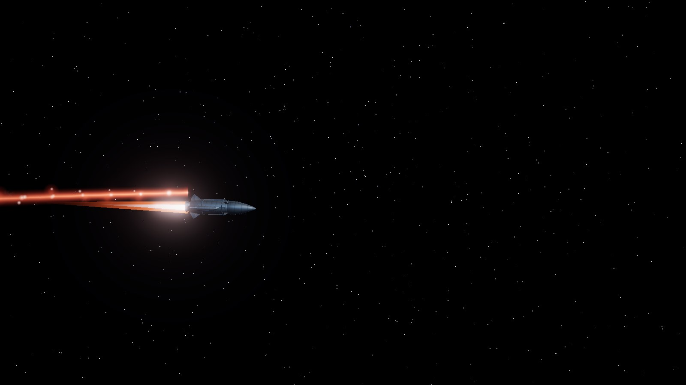 | 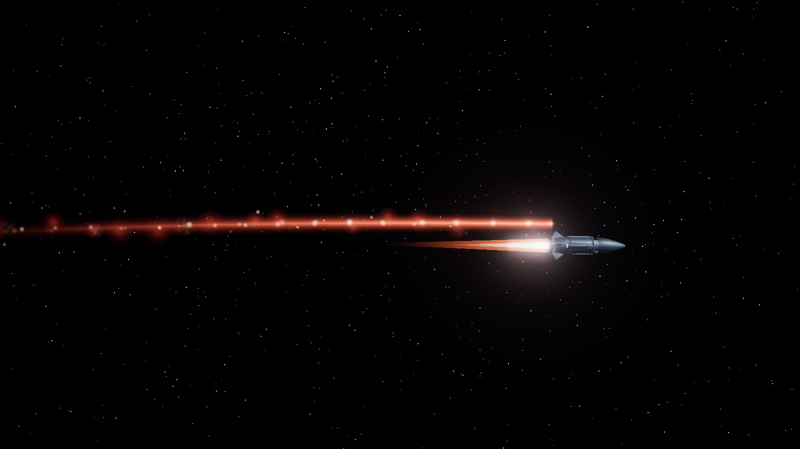 |

### 4.2 齐射

| 0.70 s | 1.20 s | 2.60 s |
|---|---|---|
|  |  | 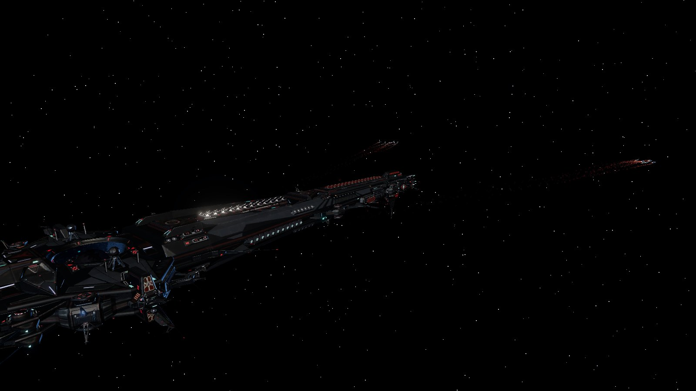 |

### 4.3 命中

| 3.11 s（命中前） | 3.35 s | 3.65 s |
|---|---|---|
|  |  | 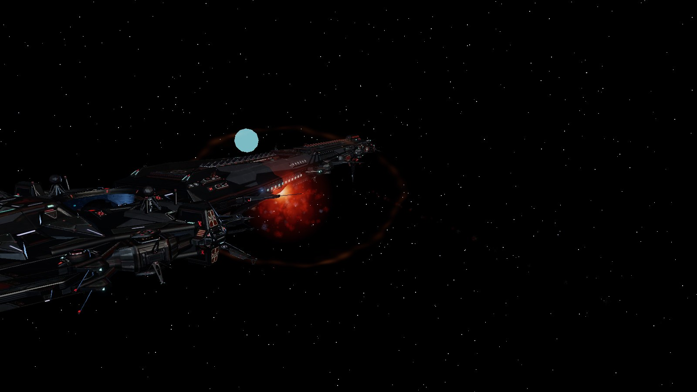 |

### 4.4 大舰死亡序列

| 9.50 s（随机模块殉爆） | 18.04 s（终末闪光） | 18.45 s（火球/残骸/冲击弧） |
|---|---|---|
|  | 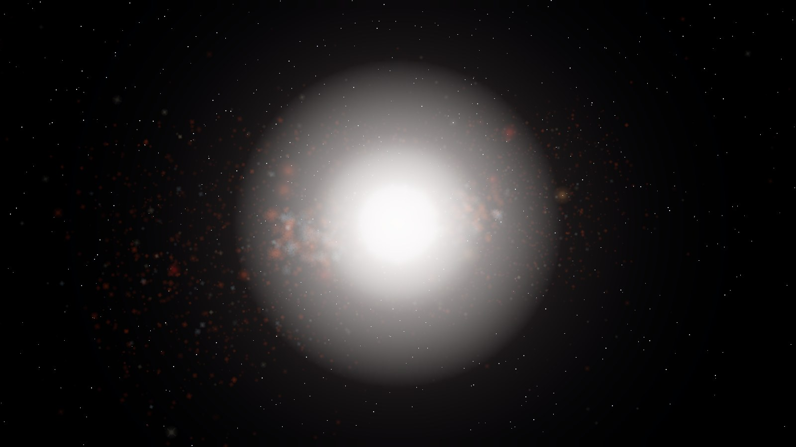 | 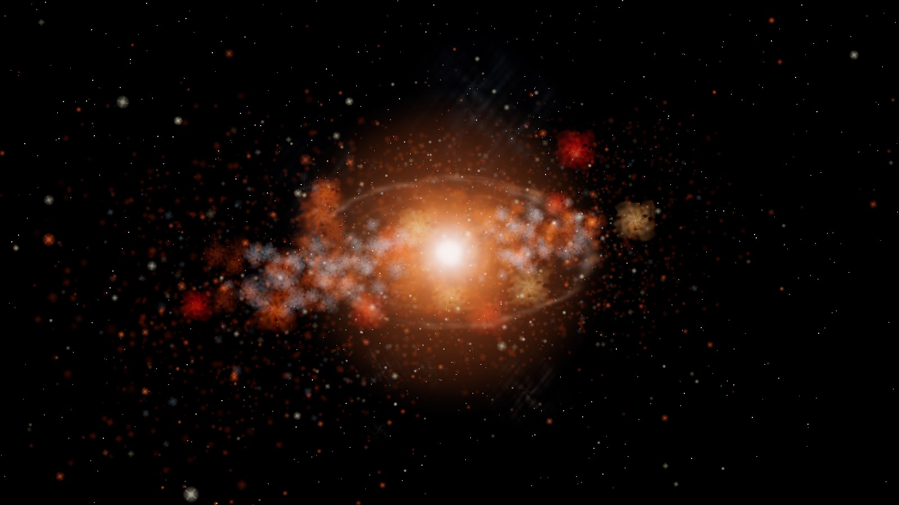 |

### 4.5 终末爆炸（v2 关键帧）

| 0.05 s | 0.30 s | 1.00 s | 2.50 s |
|---|---|---|---|
| 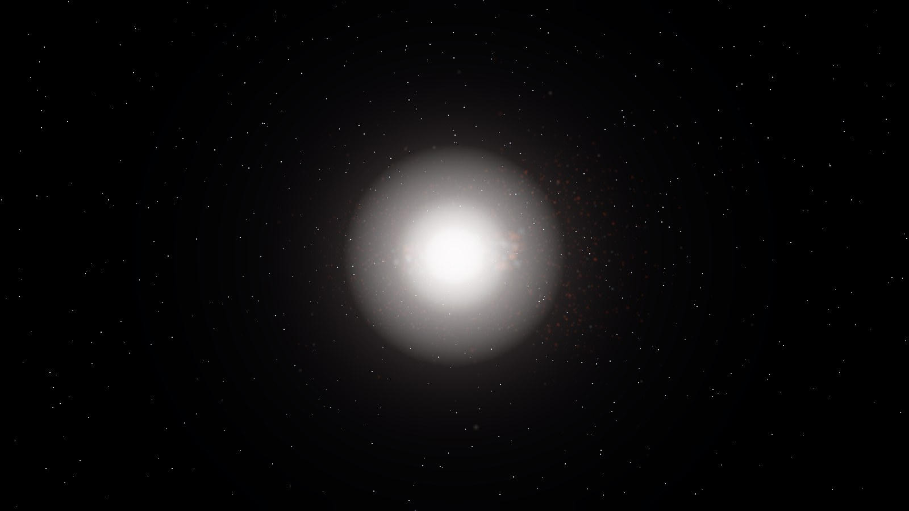 | 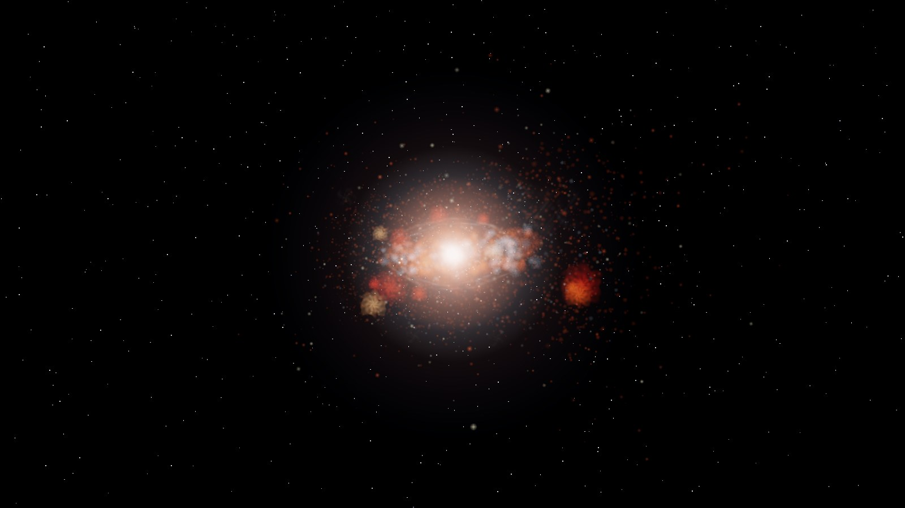 | 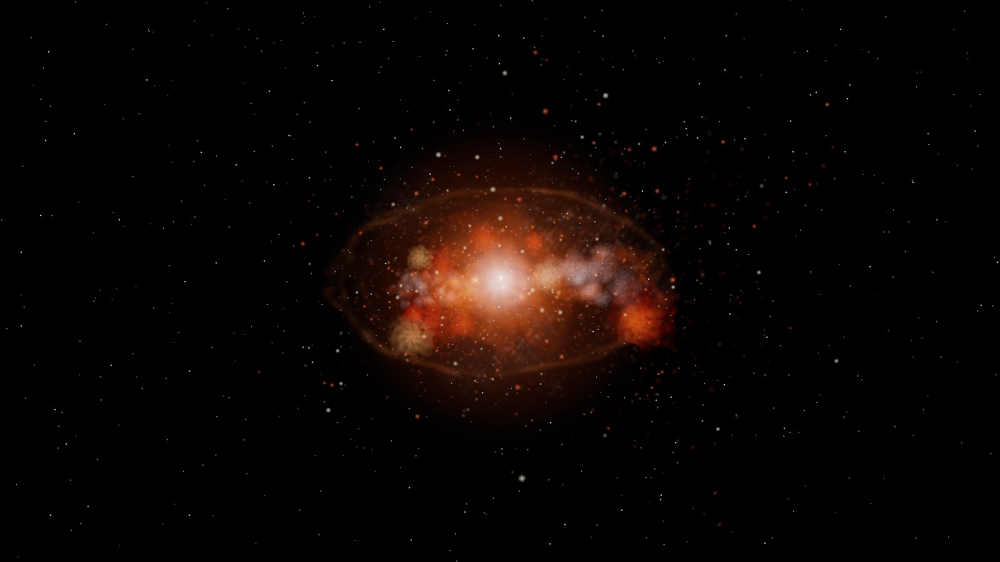 | 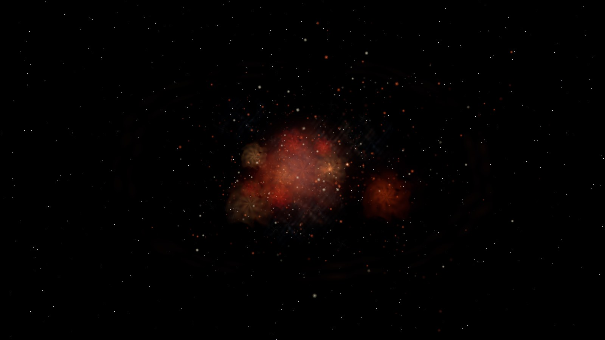 |

| 4.50 s | 7.50 s（冷却烟尘） |
|---|---|
| 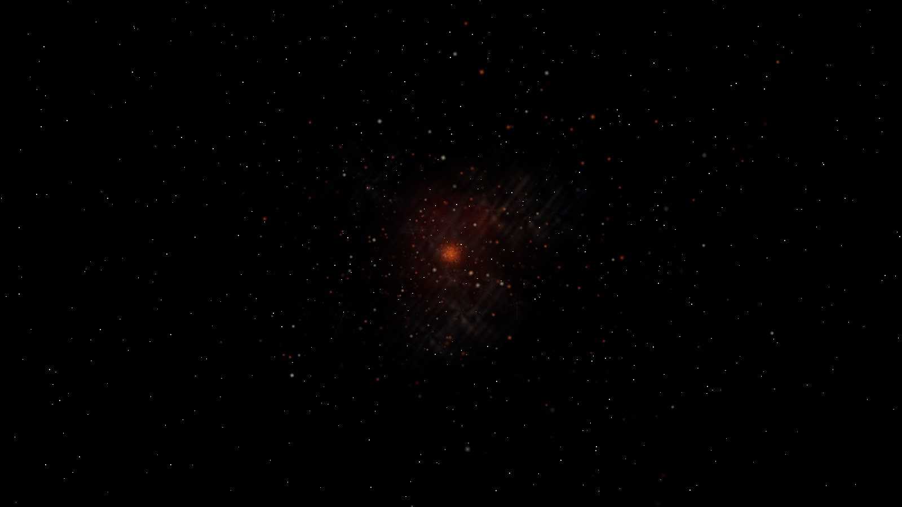 | 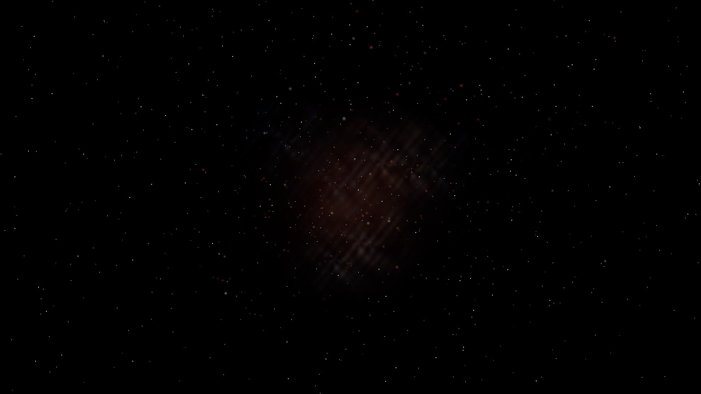 |

---

## 5. 复现 / 测试

```sh
cd /Users/apple/.local/share/opencode/worktree/e0f2de/vfx-torpedo
npm install
npm run dev -- --port 4329
# Astro 可能在 4329 被占用时自动换端口，以实际输出为准
```

测试页：

```text
/yacht/vfx-torpedo-test/?scene=torpedo&hud=0
/yacht/vfx-torpedo-test/?scene=volley&hud=0
/yacht/vfx-torpedo-test/?scene=impact&hud=0
/yacht/vfx-torpedo-test/?scene=death&hud=0
/yacht/vfx-torpedo-test/?scene=finale&hud=0
/yacht/vfx-torpedo-test/?scene=bench&hud=0
```

自动逐帧截图：

```sh
VFX_URL='http://localhost:4329/yacht/vfx-torpedo-test/' node scripts/vfx-capture.mjs
# 单场景：
VFX_SCENES=finale VFX_URL='...' node scripts/vfx-capture.mjs
```

> `vfx-capture.mjs` 原生输出 PNG；仓库截图已用 Pillow 转成 JPG 控制体积。
> 重新转 JPG：
> `python3 -c "from PIL import Image; import pathlib; [Image.open(p).convert('RGB').save(p.with_suffix('.jpg'), quality=88, optimize=True) for p in pathlib.Path('docs/vfx-torpedo').glob('*.png')]"`

检查/构建：

```sh
npm run check
npm run build
```

---

## 6. 已知限制

- **真实 GPU 帧率未测**：SwiftShader 只能说明 CPU 逻辑和 draw call 结构；30/60 FPS 需在硬件浏览器验收。
- **冲击环仍是相机朝向 Sprite**，不是真实 3D 球壳；破缺/变色/低透明度是为了视觉可读性和性能。3D Fresnel 球壳在大尺度会变成厚玻璃气泡，已移除。
- **尾迹端向淡出**：视线与航向接近平行时丝带退化，自动淡出，由粒子层保留痕迹。
- **尾迹螺旋是视觉偏移**，不改变物理轨迹/速度；3,600 m/s 的 A 鱼雷速度不变。
- **容量上限**：鱼雷实例 260/批，尾迹丝带 260 槽，火粒子 5,600，烟 1,800，火花 2,600，残骸约 620。极端刷屏时最早粒子会被覆盖，可能出现少量跳变。
- **7.5 秒后的烟尘很暗**：这是深空曝光下的冷烟，不是没有；若需要更亮，可单独提高 `smokeGlow` 的 peak 或加局部补光。
- **大舰兜底命中**：长度 ≥ 500 m 舰船鱼雷使用 0.65×collisionRadius 胶囊 + 船壳 BVH 射线吸附；对极稀疏/破损舰体可能比真实三角面略保守。
- **屏幕闪光未进 demo 截图**：demo 只跑 Combat + 后处理，屏幕闪光由 `main.ts` HUD 负责；完整游戏启动已验证无 console error。
- **音频未验证**：headless 环境不检查爆炸/鱼雷音频，但事件链路（`onExplosion` / `onSecondary`）已接通。
- **测试场景为合成场景**：星场 + Archon 模型，不等于完整游戏的光照/行星/后处理负载；完整游戏已启动验证，但未做长时间 Archon 实战。

---

## 7. 文件

新增：

- `src/game/vfx-common.ts` — 程序化贴图（火焰/分形烟/软光/火花/破缺冲击环）、固定容量 GPU 粒子场
- `src/game/torpedo-vfx.ts` — 鱼雷弹体 InstancedMesh、共享尾迹丝带、尾迹粒子、终端增推
- `src/game/explosion-vfx.ts` — 多瓣火球、破缺等离子环、5 形状残骸、预置灯光、级联殉爆
- `src/scripts/vfx-torpedo-demo.ts` — 可视/性能测试场景
- `src/pages/vfx-torpedo-test.astro` — 测试页
- `scripts/vfx-capture.mjs` — CDP 逐帧截图/性能采集
- `docs/vfx-torpedo/` — 39 张 JPG + `captures.json` + `perf.json`

修改：

- `src/game/combat.ts` — 弹丸位置/鱼雷句柄、Instanced 鱼雷接入、命中爆炸、死亡序列爆炸、长度 ≥ 500 m 舰船胶囊兜底、实例化残骸/灯光/冲击环、`vfxStats`
- `src/game/main.ts` — `onExplosion` 新增 `final` 类型、更强屏幕闪光/更长衰减
- `src/game/ships.ts` — 未改（3,600 m/s / 5–15 s 装填保持不变）
