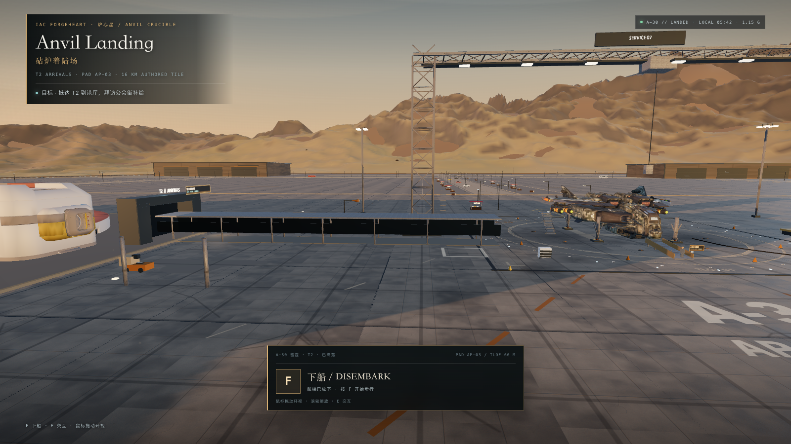
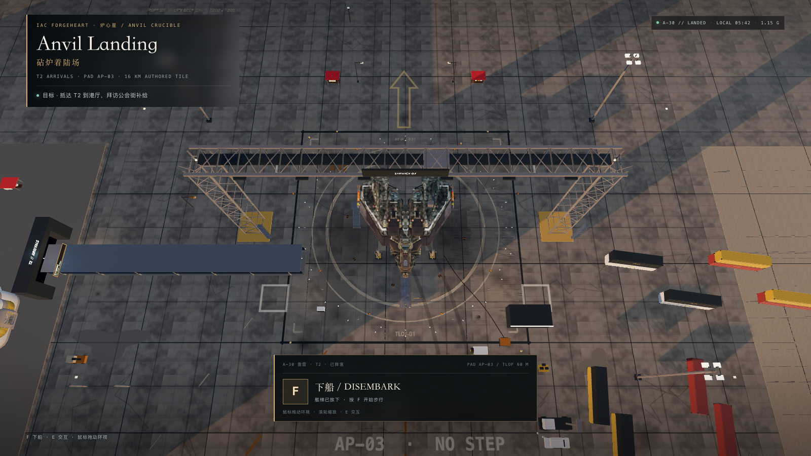
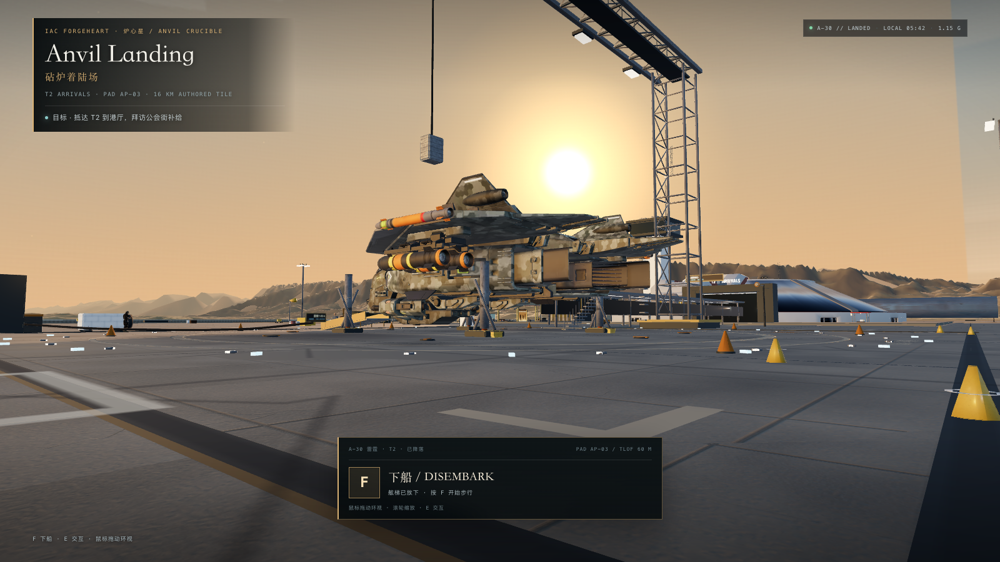
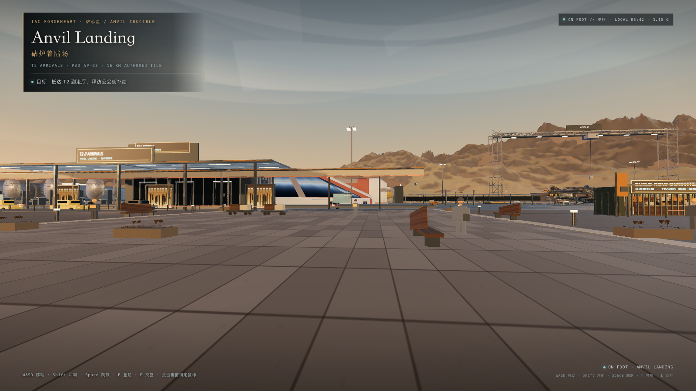
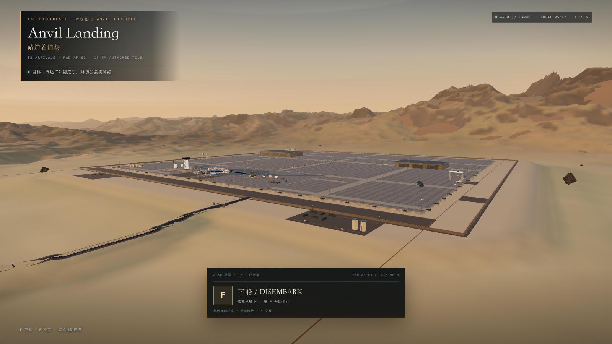
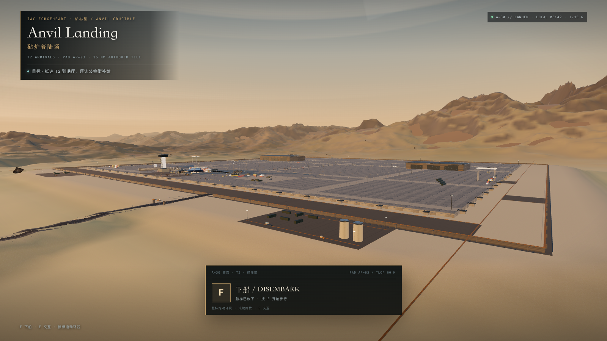

# Anvil Landing — IAC first landing vertical slice

**Route:** `/yacht/iac-landing/`
**Worktree:** `/Users/apple/.local/share/opencode/worktree/e0f2de/iac-landing`
**Status:** playable first slice plus environment-art pass (parked A-30 → disembark → first-person walk → T2 terminal → dialogue / shop → re-board).
**Built:** 2026-11-16/17

This is a standalone vertical slice. It does **not** change the main game, its flight controller, or its planet runtime. The art pass is layered on the first slice (`1846b1d`) in the `iac-landing-slice` worktree branch and is not merged.

---

## What this pass changed

- The 1.26 km port deck is now a raised engineered platform: 52 m concrete apron, 3.2 m retaining wall with buttresses, drainage plinth, service-gate ramp, and a 200 m graded cut into the basin.
- The authored 16 km tile has a 1.52 × 1.56 km terrace at 36.8 m, a dry braided riverbed, eroded gullies, a west rim, badlands, and a 13 m service road descending from the south gate.
- The white source boulders are hidden; dark basalt outcrops and low-poly boulders replace them. The flat GLB paint/timber/steel materials are dressed with procedural grunge textures.
- The landing zone has slab joints, cracks, oil/scorch marks, markings, edge lights, tie-downs, a fuel hose, cones, windsock, approach lights, cargo and service vehicles.
- T2 has a lit three-door facade, cladding band, deeper canopy with columns and warm downlights, readable T2 sign, benches, carts, queue barriers, bollards, planters and people.
- The wooden stall shop is replaced by a container outfitter at the landside forecourt, with a lit interior, stock shelving, counter, queue barriers, crates, banners and a proper sign. The old authored stall meshes are carved out.
- Two hangars, a tank farm, container stacks, floodlight masts and a terrace service yard give the deck a working-port scale rather than an empty test slab.
- Lighting is a low warm sun, cool fill, hand-authored sunset/dust sky, long shadows, fog and drifting dust. A single merged layer-1 shadow proxy replaces dozens of per-object shadow draws. No bloom.
- Eleven new screenshots, including the A-30 hero, walkway and two platform/terrain integration views.

---

## What this slice proves

| Requirement | Status |
|---|---|
| 16 km × 16 km authored terrain tile | **Real.** 641² R16 heightfield, 25 m spacing, 16.384 km square, 1.52 × 1.56 km engineered terrace at 36.8 m, 200 m cut, north ridge, east scarp, south mesas, west rim, dry riverbed, gullies and a terrain-following service road. |
| Platform / terrain integration | **Real.** The deck is a raised 1.26 km platform with a 52 m apron, a 3.2 m retaining wall and buttresses, a service ramp at the south gate, a drainage plinth and a graded cut. No floating black edge. |
| Landing-zone detail | **Real.** 160 m pad overlay with slab joints, cracks, scorch/oil marks, A-30 identity, nose box, arrows, tie-downs, edge lights, apron beacons, cones, fuel cabinet/hose, windsock, approach light masts, service tug and staged cargo. |
| Terminal facade | **Real.** Three lit arrival doors, frames, cladding panel band, deeper canopy with columns and warm strip lights, T2 sign, info panels, benches, baggage carts, queue barriers, bollards and planters. |
| Proper shop, not a wooden stall | **Real.** Container outfitter with corrugated shell, awning, sign, warm interior, shelves/stock, counter, queue barriers, crates/barrels, vertical banners and a trader. |
| Mid-ground / basin detail | **Real.** Hangars, tank farm, container stacks, cargo yard, terrace service yard, floodlight masts, service road with shoulders, guardrails and lamps, dark rock outcrops, boulder fields and scrub. |
| Lighting / atmosphere | **Real.** Low warm directional sun, cool fill, hand-authored equirect sky with dust/cirrus bands, fog, dust motes, ACES tone mapping, emissive signs/practicals, long shadows. No bloom. |
| A-30 landed ship | **Real.** Authored A-30 mesh from the city-hero-v2 scene, 25 m class; static landed node, not a vertex/scale replacement. |
| On-foot controller | **Real.** WASD, pointer lock, sprint, gravity, ground snap, jump, 1.7 m eye height, collision with terrain, deck, apron wall, terminal, gantry legs, tanks, ship and props. No flying. |
| Disembark / re-board | **Real.** Parked orbit view → F → 300 ms fade → foot pose at the ramp; F near the ramp returns to parked. No atmospheric landing sequence. |
| Interactions | **Real.** E dialogue at dockmaster/mechanic; E at the outfitter counter opens the shop; Esc closes; E advances dialogue; credits and purchase deduction. |
| HUD | **Real, minimal.** Location, mode, interaction prompt, name/role, control hint, shop credits/items. No fake oxygen/system bars. |
| Performance | **Measured on an M4 Max with ANGLE Metal** (headless Chrome, not SwiftShader): **worst captured view 93 draw calls / 1.496 M triangles; required views 63–93 calls; 60 fps**. |
| Build/check | `npm run check`, `npm run build` pass; CDP smoke test passes 15/15. |

---

## Screenshots

| | |
|---|---|
|  **01 · Wide landing zone** |  **02 · A-30 + F disembark** |
|  **03 · T2 Arrivals facade** |  **04 · Dockmaster dialogue** |
|  **05 · Guild Row Outfitter** |  **06 · Perf overlay: 60 fps / calls / tris** |
|  **07 · TLOF / gantry overview** |  **08 · Low-angle A-30 hero** |
|  **09 · T2 walkway: people, shop, terminal** |  **10 · Integrated platform / basin** |
|  **11 · Apron wall, service yard, cut slope** | |

Stats source: `stats.json`. The 06 shot is the screenshot with the live FPS/draw-call/triangle overlay; it is not a mocked number.

---

## Controls

| Key | Action |
|---|---|
| `F` | Disembark in parked mode / re-board near the A-30 ramp |
| `W A S D` | Walk |
| `Shift` | Sprint |
| `Space` | Jump |
| Mouse | Look; click the scene to lock the pointer |
| `E` | Interact / advance dialogue |
| `Esc` | Close dialogue/shop |
| `P` | Toggle the perf overlay |
| `R` | Return to the boarding ramp (debug convenience) |

---

## Measured performance

Conditions: 1600 × 900, device pixel ratio 1, headless Chrome with `--use-angle=metal`, renderer string **ANGLE (Apple, ANGLE Metal Renderer: Apple M4 Max)**. No SwiftShader.

| View | Draw calls | Triangles |
|---|---:|---:|
| 01 wide landing | 63 | 1.408 M |
| 02 disembark | 66 | 1.398 M |
| 03 T2 facade | 78 | 1.439 M |
| 04 dockmaster | 75 | 1.439 M |
| 05 outfitter / shop UI | 80 | 1.467 M |
| 06 perf wide | 63 | 1.408 M |
| 07 pad top | 71 | 1.436 M |
| 08 A-30 hero | 92 | 1.492 M |
| 09 walkway | 91 | 1.496 M |
| 10 platform overview | 93 | 1.497 M |
| 11 platform edge | 93 | 1.497 M |

FPS sample: **60 average / 60 min / 60 max** over the final parked view (vsync-capped). The smoke test measured **68 calls / 1.435 M tris / 60 fps** in its final on-foot state.

The script only counts renderer work; it does not include DOM compositing or browser overhead. This is not a benchmark of the full main-game planet/flight runtime.

Performance mechanics:
- All static environment detail is merged by material (one mesh per material), so the new walls, props, people, hangars and road cost draw calls in the tens, not hundreds.
- The sun's depth pass renders one merged layer-1 blockout (`IAC_ShadowProxy`, 31 blocks) with `shadow.camera.layers.set(1)`; visible meshes keep `receiveShadow` and lose per-object shadow draws.
- Ambient people are low-poly merged figures (4 material buckets); the three interactive NPCs remain separate posed meshes.

---

## What is real vs mocked

### Real

- **Terrain:** deterministic authored heightfield generated by `tools/terrain/generate_iac_16km.py`; the visual mesh and CPU collision sampler read the same R16 grid. The 48 km backdrop is coarse and fog-hidden. The terrace, cut, berm, drainage ditch, riverbed, gullies, west rim, badlands and service-road cut are authored, not runtime noise.
- **Platform integration:** deck top 40.32 m, apron 40.03 m, terrace 36.8 m, retaining wall top ~41.1 m. The deck/ramp/apron heights are part of `groundAt`, so walking and falling use the same surfaces that are drawn.
- **Port geometry:** terminal, T2 landside hall, gantry, control tower, tanks, ship and NPCs derive from the authored city-hero-v2/Kitbash assets. The environment-art module adds the apron, walls, ramp, shop, forecourt, hangars, container stacks, service yard, pad markings and props, merged by material.
- **Material dressing:** the old flat GLB paint/timber/steel materials get procedural grunge maps at runtime; the old wooden market stalls are carved out of the merged source meshes.
- **Player physics:** fixed 1/60 s kinematic controller; eye 1.7 m; walk 4.6 m/s; sprint 7.2 m/s; gravity 11.28 m/s²; jump 4.8 m/s; step 0.42 m; ground snap 0.4 m. Terrain heightfield + AABB collision for terminal, hall, apron wall, gantry, tanks, ship and props.
- **Interactions:** proximity selection, name/role prompt, E dialogue, E shop, Esc close, credits and purchase deduction.
- **Lighting:** one directional sun shadow map, a single merged shadow proxy, ACES, fog, emissive canvas signs and practical lights. No bloom pass.

### Mocked / placeholder (be honest)

- **Shop economy:** three placeholder items, in-memory credits, no persistence, inventory, stock or backend.
- **Dialogue:** static line lists; no branching, quests, conditions, voice or lip sync.
- **Interactive NPCs:** static posed Modelshop meshes with a whole-group look-at/sway. No rigged locomotion, foot IK, facial animation or crowd system.
- **Ambient people:** deliberately low-poly merged figures (box torso/limbs + sphere head, 4 material buckets). They read at walkway distance but are not a crowd simulation and have no collision.
- **Ship:** static authored A-30 node. No gear/ramp animation, cockpit, flight model, atmospheric entry or real landing sequence on this page.
- **Terminal interior:** not enterable. T2 is an exterior facade/hall shell with lit door planes; there is no interior scene/portal.
- **Terrain runtime:** one 16 km mesh plus a 48 km backdrop, no quadtree, tiles, LOD streaming or CSM. The main game's planet sphere and `surface.ts` are untouched.
- **Sky / clouds:** hand-authored equirect canvas with procedural cloud/dust bands, not volumetric clouds or a time-of-day system.
- **Dust:** 900 drifting points plus fog; no fluid/smoke simulation.
- **Hangars / far deck:** simple industrial blocks and container rows, intended to read at overview distance. Up close they are low-detail compared with the terminal.
- **Road:** ribbon + shoulders + guardrails + lamps, not a navigation graph; the player can walk down the gate ramp but there is no traffic AI.
- **Collision:** major props are AABBs; some small crates, cones and ambient people are non-colliding.
- **Audio / save / missions:** none.
- **Source prop leftovers:** a few authored port props (white tank shapes, yellow cargo boxes) remain simple GLB geometry with procedural surface dressing; they were not remodeled in this pass.
- **Generated screenshots:** include the game HUD (including the disembark panel in the hero); they are gameplay captures, not clean marketing renders.

---

## Assets / licensing caveat

The port, terminal, gantry, fuel farm, A-30 and NPC meshes are derived from local paid libraries used by the existing city-hero-v2 sample (Kitbash3D kits, the 650M1 CommunityCentre, Modelshop Greebles). The project is non-commercial, but standard EULAs generally do not allow standalone redistribution. **Before a public deploy, decide whether to keep this page private, replace the derived meshes with project-owned/CC0 assets, or verify the relevant licenses.** The heightfield, environment art, extra props, procedural textures and low-poly ambient people are project-authored. The terrain detail textures come from the existing project terrain sample.

---

## Files

```
src/pages/iac-landing.astro          page / HUD / panels / CSS
src/scripts/iac-landing.ts           boot, mode/UI/interaction loop, sky, lights, capture API
src/game/iac/terrain.ts              16 km heightfield mesh, splat shader, backdrop, walk surfaces
src/game/iac/player.ts               first-person controller, ground sampler, AABB collision
src/game/iac/port.ts                 port GLB, NPCs, colliders, carved stalls, ambient anchors
src/game/iac/env-art.ts              apron/wall/ramp, T2 facade detail, container shop, pad props,
                                     hangars, yards, roads, rocks, scrub, people, dust, signage
src/game/iac/shadow.ts               one merged layer-1 shadow proxy
tools/terrain/generate_iac_16km.py   deterministic terrain/splat/macro generator (Python 3 + numpy + Pillow)
scripts/iac-capture.mjs              CDP screenshots + perf JSON
scripts/iac-smoke.mjs                CDP gameplay smoke test (movement, collision, UI)
scripts/merge-pupils.mjs             NPC primitive-draw-call cleanup
public/iac-landing/terrain/          R16 heightfields, splat/macro, detail textures
public/iac-landing/assets/           anvil-landing.glb, npcs.glb
docs/iac-landing/                    this report, 11 screenshots, stats.json
```

---

## Run / verify

```sh
cd /Users/apple/.local/share/opencode/worktree/e0f2de/iac-landing
npm install
npm run dev -- --port 4330
# open http://localhost:4330/yacht/iac-landing/

npm run check
npm run build

# capture screenshots + stats (dev server on 4330 by default)
node scripts/iac-capture.mjs

# gameplay smoke test (same dev server)
node scripts/iac-smoke.mjs
```

If the dev server runs on 4329, set:

```sh
IAC_URL=http://localhost:4329/yacht/iac-landing/ node scripts/iac-capture.mjs
IAC_URL=http://localhost:4329/yacht/iac-landing/ node scripts/iac-smoke.mjs
```

The smoke test dispatches synthetic `KeyboardEvent`s because headless Chrome batches CDP key state; the real window keydown path is the same listener.

---

## Next step: connect to the main game

1. **Lift the surface modules** (`terrain.ts`, `player.ts`, port/interaction logic) into `src/game/surface/`; add the `SurfaceFrame`/`SurfaceRoot`, `InputRouter` and `SurfaceMode` state machine from docs 11–14. The page's player, ground sampler and AABB collider list are already modular.
2. **Disable the flight controller on foot.** `FlightController` must get `enabled`/`setMode()` and an input router; today it listens globally. Map `flight`, `landed`, `foot`, `ui` modes.
3. **Replace the planet branch of `startDock`/`finishDock`** with `LandingSystem` from doc 14. Use the prepared `PadFrame` (AP-03, 60 m TLOF, 87° heading), analytic pad contact, gear/ramp sockets and the real A-30 from `ships.ts`. The current page's landed node is a placeholder for that handoff.
4. **Swap the current 641² static terrain for the tile streamer** (`.cterr`, quadtree LOD, 1 km tiles) described in doc 11. The heightfield, splat language, terrace carve, road and collision sampler should carry over.
5. **Promote the shop/dialogue to the main save/economy system.** The current item data and credits are deliberately in-memory placeholders; the DOM overlay and modal stack can be reused.
6. **License decision** for the port/terminal/NPC assets before any public deploy; keep this page private if the source library EULA is not cleared for redistribution.

Known blockers are listed above; the biggest ones are asset licensing, main-game input/state integration, and the streamed-terrain/landing-system handoff.
