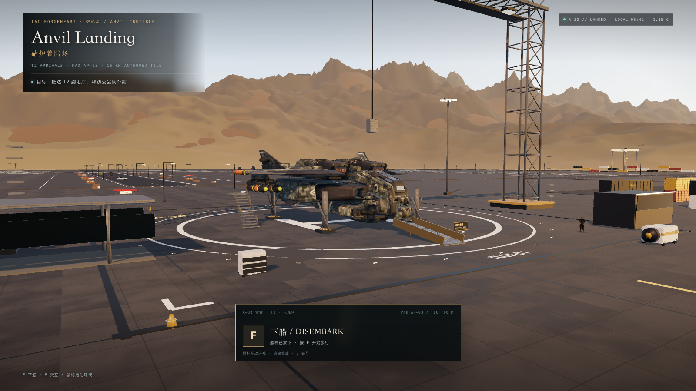
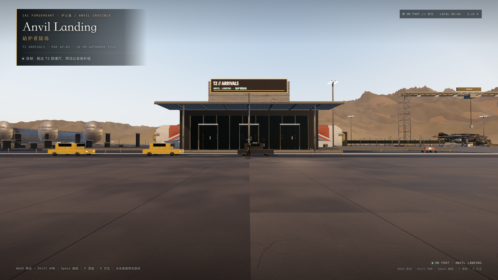
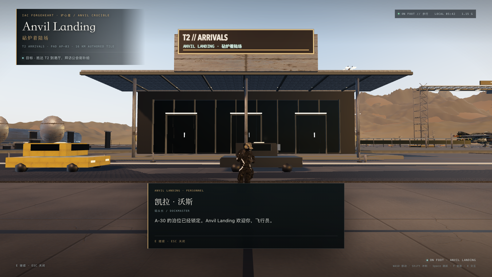
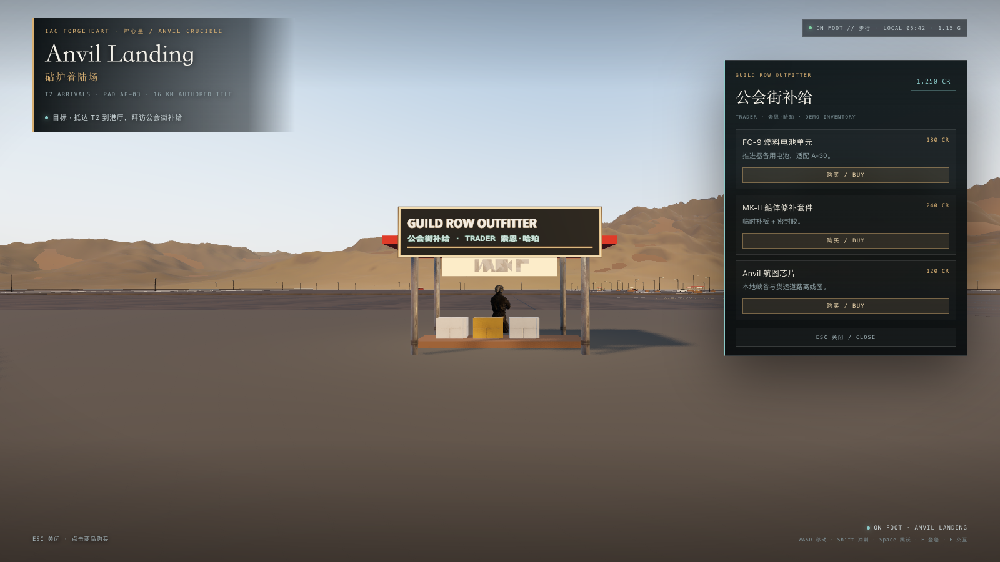
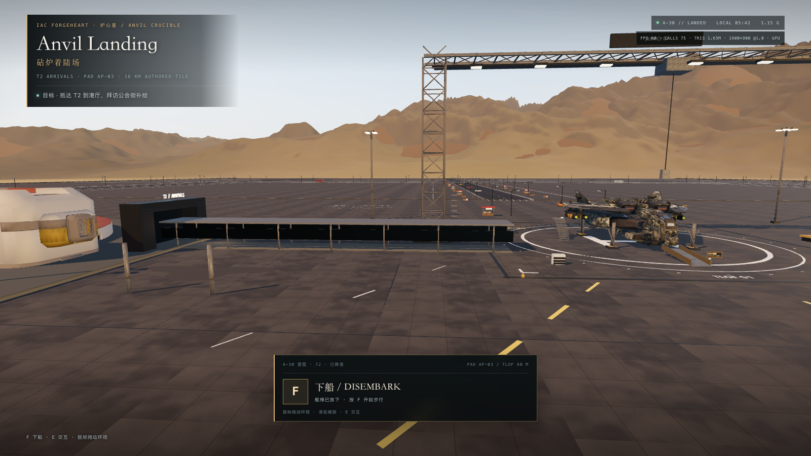
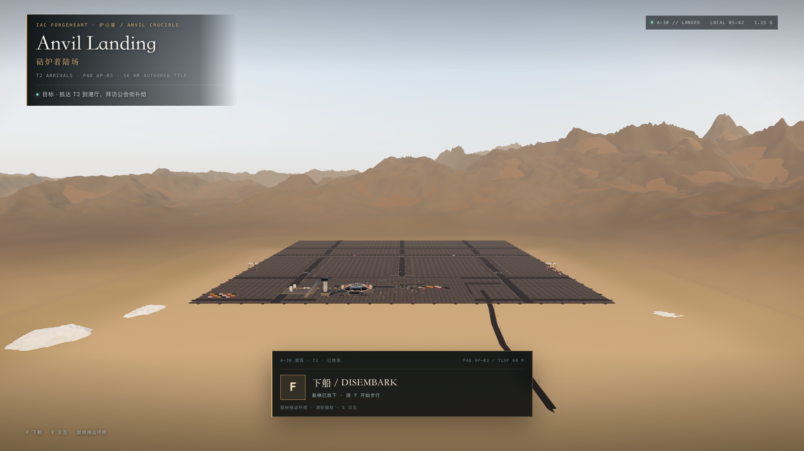
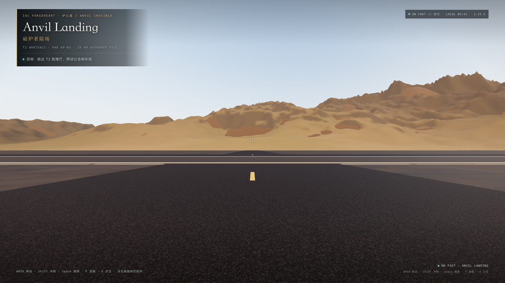

# Anvil Landing — IAC first landing vertical slice

**Route:** `/yacht/iac-landing/`
**Worktree:** `/Users/apple/.local/share/opencode/worktree/e0f2de/iac-landing`
**Status:** playable first slice (parked A-30 → disembark → first-person walk → T2 terminal → dialogue / shop → re-board).
**Built:** 2026-11-16/17

This is a standalone vertical slice. It does **not** change the main game, its flight controller, or its planet runtime.

---

## What this slice proves

| Requirement | Status |
|---|---|
| 16 km × 16 km authored terrain tile | **Real.** 641² R16 heightfield, 25 m spacing, 16.384 km square, 2.2 × 2.6 km flat industrial plateau at 40 m, north ridge, east scarp, canyon, road. |
| Flat industrial plateau / landing zone | **Real.** 1.2 km authored port deck on a wider ash plateau; a 32 cm curb is intentional. |
| Landed A-30 with native geometry | **Real.** Authored A-30 mesh from the city-hero-v2 scene, 25 m class, no vertex/scale replacement; separate node in the port GLB. |
| Anvil Landing: 60 m TLOF, terminal, shop, 3 NPCs, gantry, containers, fuel tanks, lights, cables, crates | **Real port set.** Reused authored terminal/gantry/fuel/market/container assets; shop stall placed at the deck edge; non-trivial props cast shadows. |
| On-foot first-person controller | **Real.** WASD, pointer lock, sprint, gravity, ground snap, jump, 1.7 m eye height, collision with terrain, deck, terminal, gantry legs, tanks, stalls, containers, ship/ramp. No flying. |
| Disembark / re-board transition | **Real.** Parked orbit view → F → 300 ms fade → foot pose at the ramp; F near the ramp returns to the parked view. No full atmospheric landing sequence. |
| Interactions | **Real.** E opens a dialogue at the dockmaster/mechanic; E at the counter opens the shop; Esc closes; E advances dialogue. |
| HUD | **Real, minimal.** Location, mode, interaction prompt, name/role near prompt, control hint, shop credits/items. No fake oxygen/system bars. |
| Realistic lighting | **Real.** CC0 HDRI sky, PMREM environment, directional sun with 2048 PCF shadows, ACES tone mapping, fog, emissive signage, pad practicals. No bloom pass. |
| Performance | **Measured on an M4 Max with ANGLE Metal** (headless Chrome, not SwiftShader): **worst captured view 98 draw calls / 1.745 M triangles; required views 64–84 calls / 1.60–1.68 M; 60 fps**. |
| Build/check | `npm run check`, `npm run build` pass; CDP smoke test passes. |

---

## Screenshots

| | |
|---|---|
|  **01 · Wide landing zone** |  **02 · A-30 + F disembark** |
|  **03 · On foot at T2 Arrivals** |  **04 · Dockmaster dialogue** |
|  **05 · Guild Row Outfitter** |  **06 · Perf overlay: 60 fps / calls / tris** |
|  **07 · TLOF / gantry overview** |  **08 · 16 km plateau overview** |
|  **09 · Cargo road + north ridge** | |

Stats source: `stats.json`. The 06 shot is the screenshot with the live FPS/draw-call/triangle overlay; it is not a mocked number.

---

## Controls

| Key | Action |
|---|---|
| `F` | Disembark in parked mode / re-board near the A-30 ramp |
| `W A S D` | Walk |
| `Shift` | Sprint |
| `Space` | Jump |
| Mouse | Look; click the scene to lock the pointer |
| `E` | Interact / advance dialogue |
| `Esc` | Close dialogue/shop |
| `P` | Toggle the perf overlay |
| `R` | Return to the boarding ramp (debug convenience) |

---

## Measured performance

Conditions: 1600 × 900, device pixel ratio 1, headless Chrome with `--use-angle=metal`, renderer string **ANGLE (Apple, ANGLE Metal Renderer: Apple M4 Max)**. No SwiftShader.

| View | Draw calls | Triangles |
|---|---:|---:|
| 01 wide landing | 75 | 1.650 M |
| 02 disembark | 73 | 1.609 M |
| 03 T2 terminal | 84 | 1.679 M |
| 04 dockmaster | 81 | 1.679 M |
| 05 shop | 64 | 1.601 M |
| 06 perf wide | 75 | 1.650 M |
| 07 pad top | 81 | 1.677 M |
| 08 16 km overview | 98 | 1.745 M |
| 09 ridge vista | 45 | 1.499 M |

FPS sample: **60 average / 60 min / 60 max** over the final parked view. The display is vsync-capped at 60; the draw/triangle budget is the meaningful headroom metric here. The smoke test measured `81 calls / 1.677 M tris / 60 fps` in its final on-foot state.

The script only counts renderer work; it does not include DOM compositing or browser overhead. The scene is not a benchmark of the full main-game planet/flight runtime.

---

## What is real vs mocked

### Real

- **Terrain:** deterministic authored heightfield generated by `tools/terrain/generate_iac_16km.py`; the visual mesh and CPU collision sampler read the same R16 grid. The outer 48 km backdrop is coarse and fog-hidden.
- **Port geometry:** the terminal, T2 landside facade, gantry, control tower, fuel tanks, containers, crates, market row, shop stall, ramps, lights and deck are exported from the authored `city-hero-v2` Blender scene, decimated and material-consolidated. The A-30 node is the authored A-30 geometry (separate from the static port).
- **Player physics:** fixed 1/60 s kinematic capsule-ish controller; eye 1.7 m; walk 4.6 m/s; sprint 7.2 m/s; gravity 11.28 m/s²; jump 4.8 m/s; step 0.42 m; ground snap 0.4 m. Terrain/deck heightfield + AABB collision for terminal, landside hall, gantry legs, tanks, stalls, containers, ship and ramp.
- **Interactions:** proximity selection, name/role prompt, E dialogue, E shop, Esc close, credits and purchase deduction.
- **Disembark / re-board:** actual player pose change at the ramp; parked orbit camera; fade transition.
- **Lighting:** HDR sky, PMREM environment, sun shadow map, ACES, fog, emissive canvas signs and practical lights. No bloom.

### Mocked / placeholder (be honest)

- **Shop economy:** three placeholder items, in-memory credits, no persistence, inventory, stock, or backend.
- **Dialogue:** static line lists; no branching, quests, conditions, voice, or lip sync.
- **NPCs:** static posed Modelshop meshes with a whole-group sway and look-at rotation. No rigged locomotion, foot IK, facial animation, or crowd system. Eyes are merged into the glove material to save draw calls.
- **Ship:** the landed A-30 is a static authored node. There is no gear/ramp animation, cockpit, flight model, atmospheric entry, or real landing sequence on this page. The main game's `loadShipModel()` is not used yet.
- **Terminal interior:** not enterable. T2 is an exterior facade/hall shell; the shop is an exterior counter under a stall canopy. There is no interior scene/portal.
- **Terrain runtime:** one 16 km mesh plus a 48 km backdrop, no quadtree, tiles, LOD streaming, or CSM. The main game's planet sphere and `surface.ts` are untouched.
- **Collision:** major props are AABBs; no per-triangle BVH for buildings, no capsule-vs-triangle query for every prop, and some small crates/barrels are not colliding.
- **Ocean/water/lava:** none in this slice.
- **Audio:** none.
- **Save/missions/quests:** none.
- **The T2 sign:** `T2 // ARRIVALS / ANVIL LANDING` is a runtime canvas overlay. The original Nautilus Reach sign geometry was removed from the port export, and the overlay is mounted on a simple backing board.
- **The market stall:** keeps its authored mirrored “MART” label; the new `GUILD ROW OUTFITTER` sign is the readable shop brand.
- **Port deck curb:** the 1.2 km deck is 32 cm above the plateau; the curb/retaining lip is visible in the overview. It is intentional geometry, not a floating island, but it has not been blended into a terrain berm yet.
- **Cargo road:** generated ribbon with dashes and instanced lamps; it is a visual/collision-free road on the plateau, not a road graph.

---

## Assets / licensing caveat

The port, terminal, gantry, fuel farm, market props, A-30 and NPC meshes are derived from local paid libraries used by the existing city-hero-v2 sample (Kitbash3D kits, the 650M1 CommunityCentre, Modelshop Greebles). The project is non-commercial, but the standard EULAs generally do not allow standalone redistribution. **Before a public deploy, decide whether to keep this page private, replace the derived meshes with project-owned/CC0 assets, or verify the relevant licenses.** The terrain heightfield is generated by this repo; the detail textures are the existing project terrain-sample textures.

---

## Files

```
src/pages/iac-landing.astro          page / HUD / panels / CSS
src/scripts/iac-landing.ts           boot, mode/UI/interaction loop, capture API
src/game/iac/terrain.ts              16 km heightfield mesh, splat shader, road, backdrop
src/game/iac/player.ts               first-person controller, ground sampler, AABB collision
src/game/iac/port.ts                 port GLB, NPCs, shop sign, T2 sign, ramp, lights, colliders
tools/terrain/generate_iac_16km.py   deterministic 16 km heightfield/splat/macro generator (Python 3 + numpy + Pillow)
scripts/iac-capture.mjs              CDP screenshots + perf JSON
scripts/iac-smoke.mjs                CDP gameplay smoke test (movement, collision, UI)
scripts/merge-pupils.mjs             NPC primitive-draw-call cleanup
public/iac-landing/terrain/          R16 heightfields, splat/macro, detail textures
public/iac-landing/assets/           anvil-landing.glb, npcs.glb
docs/iac-landing/                    this report, 9 screenshots, stats.json
```

---

## Run / verify

```sh
cd /Users/apple/.local/share/opencode/worktree/e0f2de/iac-landing
npm install
npm run dev -- --port 4330
# open http://localhost:4330/yacht/iac-landing/

npm run check
npm run build

# capture screenshots + stats (dev server on 4330 by default)
node scripts/iac-capture.mjs

# gameplay smoke test (same dev server)
node scripts/iac-smoke.mjs
```

If the dev server runs on 4329, set:

```sh
IAC_URL=http://localhost:4329/yacht/iac-landing/ node scripts/iac-capture.mjs
IAC_URL=http://localhost:4329/yacht/iac-landing/ node scripts/iac-smoke.mjs
```

The smoke test currently dispatches synthetic `KeyboardEvent`s because headless Chrome batches CDP key state; the real window keydown path is the same listener. `F` was also verified through CDP input during development.

---

## Next step: connect to the main game

1. **Lift the surface modules** (`terrain.ts`, `player.ts`, port/interaction logic) into `src/game/surface/`; add the `SurfaceFrame`/`SurfaceRoot`, `InputRouter`, and `SurfaceMode` state machine from docs 11–14. The page's player, ground sampler and AABB collider list are already modular.
2. **Disable the flight controller on foot.** `FlightController` must get `enabled`/`setMode()` and an input router; today it listens globally. Map `flight`, `landed`, `foot`, `ui` modes.
3. **Replace the planet branch of `startDock`/`finishDock`** with `LandingSystem` from doc 14. Use the prepared `PadFrame` (AP-03, 60 m TLOF, 87° heading), analytic pad contact, gear/ramp sockets, and the real A-30 from `ships.ts`. The current page's landed node is a placeholder for that handoff.
4. **Swap the current 641² static terrain for the tile streamer** (`.cterr`, quadtree LOD, 1 km tiles) described in doc 11. The heightfield, splat language, plateau carve and collision sampler should carry over.
5. **Promote the shop/dialogue to the main save/economy system.** The current item data and credits are deliberately in-memory placeholders; the UI shape (DOM overlay, modal stack) can be reused.
6. **License decision** for the port/terminal/NPC assets before any public deploy; keep this page private if the source library EULA is not cleared for redistribution.

Known blockers are listed above; the biggest ones are asset licensing, main-game input/state integration, and the streamed-terrain/landing-system handoff.
