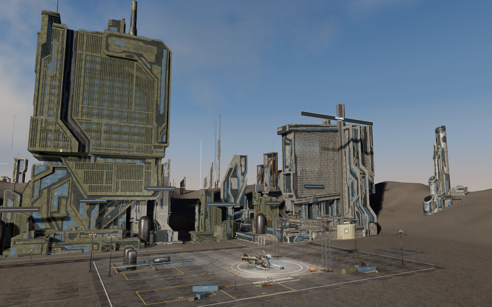
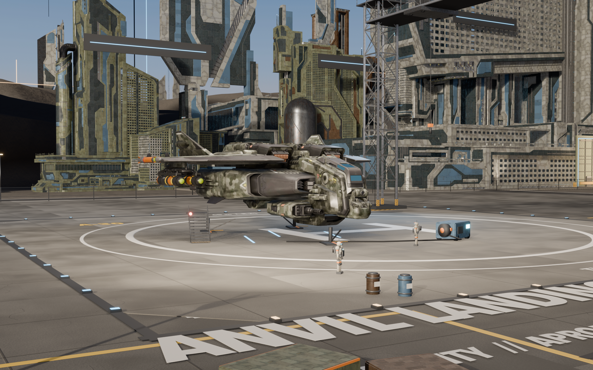
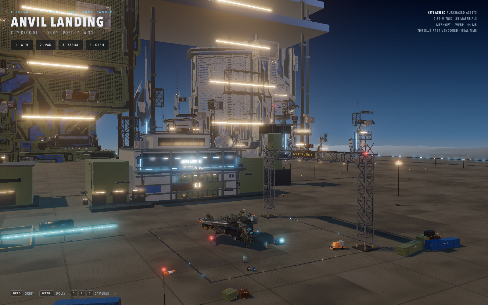

# Anvil Landing — Kitbash3D Sci-Fi Industrial hero scene

A private, non-commercial quality proof for the **Anvil Landing** port: a 200 m-scale
sci-fi industrial apron with a 60 × 60 m TLOF, a parked **A-30 Thunderbolt**, a
56 m-span service gantry, cryo tanks, pipe racks, containers, a terminal/control tower,
a hangar, a skybridge, a city edge and a rocky desert backdrop.

All of the buildings and most of the dressing are the user's purchased **Kitbash3D
Sci-Fi Industrial** FBX modules, with the original PBR maps. No procedural boxes are
used as hero buildings.

## Renders (Blender 5.3, EEVEE, 1920 × 1200)

| | |
|---|---|
|  |  |
| **01_wide_port** — apron, TLOF, ship, gantry and hero façades | **02_pad_closeup** — A-30 on TLOF-01, crew, GPU, hangar sign |
|  | |
| **03_elevated_city** — port layout, city edge, road, cliff rim | |

Raw renders are in `renders/`; a light post-grade (contrast, warmth, vignette,
sharpen) was applied. The Blender renders use the full-resolution meshes and 4K
Kitbash3D maps; the real-time GLB below is a separate, decimated build.

## Real-time kit



- `glb/anvil_landing_port.glb` — **25.57 MB / ~1.15 M tris / 40 materials**
  in Three.js (38 compact kit materials + the A-30's two original materials)
- 12 WebP textures (2K base colours, 1K normals, 512 metallic/roughness/emissive;
  AO + material tint baked into base colour)
- `EXT_meshopt_compression`, `EXT_texture_webp`, `KHR_mesh_quantization`
- Logical meshes: `RT_Buildings`, `RT_City`, `RT_Ground`, `RT_Port`, `RT_Ship`,
  `RT_People`; the exporter and gltf-transform collate primitives by material
- Hero scale: **10×** (Kitbash3D 1/10-scale modules)
- Decimation: G 0.22, H 0.20, I 0.32, J 0.40, city duplicates 0.10, port/gantry 0.55,
  terrain 0.35, cliff 0.42, ship 0.90; small props and neon strips skipped
- Preview: serve the folder over HTTP, e.g.
  `cd docs/kitbash-port && python3 -m http.server 8765`, then open
  `http://localhost:8765/preview/`. Three.js r187 is loaded from jsDelivr; the page
  supplies `MeshoptDecoder` for the compressed kit.

## Layout / scale

| Element | Notes |
|---|---|
| Apron | 210 × 140 m chamfered slab, taxiway east/west, painted stands and title |
| TLOF-01 | 60 × 60 m chamfered pad, 42 m ring, H marking, cyan edge lights |
| A-30 | 25.0 m long (source 30 m, scaled 0.833), yaw 72°, custom landing skids |
| Gantry 02 | 56 m span × 24 m high; lattice towers, catwalk, trolley/hook, work lights |
| Hero buildings | Kitbash3D modules authored at 1/10 scale; placed at **10×**: G ≈281 m, H ≈253 m, I ≈171 m, J ≈161 m |
| Control cab | 4 m glass drum on the terminal roof, warm interior + beacon |
| Skybridge | enclosed 22 m bridge between H and I at ≈ 12 m |
| Hangar | 11 m door with warm interior spill and ANVIL LANDING sign |
| City edge | LG/MD/SM kit duplicates at 0.10 decimation for the GLB, road + fence |
| Terrain | generated 1.3 km heightfield, cliff escarpment, generated PBR maps |
| Crew | four 1.86 m suited figures (built from primitives, not scanned) |

## Asset audit

`asset_audit.json` (Sci-Fi Industrial FBX):

- 359 meshes, 4,990,134 tris, 12 material sets: Metal, MetalSilver, PanelsWhite,
  PanelsBlack, PanelsBrown, Panels2, PanelsLightBlue, Iron, Glass, Tech, lights, Floor
- 30 building modules: 10 LG, 10 MD, 10 SM + 32 prop modules
  (Vent, Box, Pipe, Tank, Detail, Screw, Railing, Pole, Antenna, Door, Window,
  Gate, Roof_Panel, Chest, Column, Panel_Big)
- Hero selection: **G / H / I / J**; secondary SM_C/SM_H; city-edge B/C/D duplicates
- Props are authored at 1/10 building scale; doors, vents, antennae etc. are scaled
  ×10 and placed as real dressing.

`asset_audit_industrial.json` is a bonus audit of the local Kitbash3D Industrial
factory pack (crane/container candidates); it was not needed in the final scene.

## Material mapping

| Kit material | Source maps | Blender treatment | GLB treatment |
|---|---|---|---|
| Metal / Iron | `KB3D_SF_Metal_*`, `Iron_*` | full PBR + AO | 2K/1K compact PBR, tint/AO baked |
| PanelsWhite / Black / Brown / 2 / LightBlue | matching `KB3D_SF_Panels*` | full PBR + AO + cool/warm tint | compact PBR, tint/AO baked |
| Glass | `Glass_basecolor/normal/roughness/opacity` | transmission 0.12, reflective | opaque dark reflective (real-time approximation) |
| Tech | `Tech_*`, emissive | PBR + 2.0 emission | compact PBR + emissive |
| lights | `Lights_*`, emissive | 9.0 emission | compact base + emissive strength |
| Floor | `Floor_*` | PBR | 1K compact PBR |
| Custom | hazard, paint, neon, concrete, terrain, cliff, suit | generated/procedural | compact 1K/2K game materials |

The full 4K sources live in `/tmp/kb3d_tex/Textures` (external); the generated
terrain/concrete/hazard maps are committed in `textures/` for reproducibility.

## Reproduce

Prerequisites: Blender 5.3, Python 3 with Pillow/Numpy, the purchased FBX at
`/tmp/kb3d_fbx/asset_1.fbx`, Kitbash3D textures at `/tmp/kb3d_tex/Textures`, and
`public/models/thunderbolt.glb` in the main repo.

```bash
# 1. procedural sky / concrete / terrain maps
python3 scripts/kitbash/gen_textures.py

# 2. full-detail Blender scene (writes docs/kitbash-port/anvil_landing.blend)
/Applications/Blender.app/Contents/MacOS/Blender -b -P scripts/kitbash/build_scene.py

# 3. final 1920x1200 renders
/Applications/Blender.app/Contents/MacOS/Blender -b -P scripts/kitbash/render.py -- --final

# 4. subtle final grade
python3 scripts/kitbash/grade_renders.py

# 5. compact textures + real-time GLB
python3 scripts/kitbash/make_rt_textures.py
/Applications/Blender.app/Contents/MacOS/Blender -b -P scripts/kitbash/export_glb.py
cd docs/kitbash-port/glb
/Users/apple/orca/projects/verlins_home/node_modules/.bin/gltf-transform optimize \
  anvil_landing_port_raw.glb anvil_landing_port.glb \
  --compress meshopt --texture-compress webp --simplify false --palette false \
  --join true --instance false --texture-size 2048
```

The 122 MB `anvil_landing.blend` is kept locally for inspection but is not committed
(the worktree branch carries the scripts, generated textures, renders and GLB). The
scene can be rebuilt exactly from the steps above. `renders/raw/` is an intermediate
grade source and is git-ignored.

## Limitations

- The GLB approximates glass as opaque reflective dark glass; Blender uses transmission.
- The full-detail scene is 6.1 M tris; the real-time kit is 1.19 M tris. Hero
  façades are decimated in the GLB; the renders use the full geometry.
- The A-30 asset has no landing gear; three skids and a boarding stair were authored.
- Humans are minimal custom suited figures for scale, not scanned characters.
- The city edge / cliff / terrain are backdrop elements; the focal detail is the
  port, ship and hero façades.
- EEVEE was used for renders; no Cycles pass. The EEVEE shadow pool is raised to 2048 MB.
- Preview loads Three.js r187 from jsDelivr and needs an HTTP server (not `file://`).

Assets are the user's purchased Kitbash3D / A-30 models; this is a private sample, no
redistribution or license review is implied.
