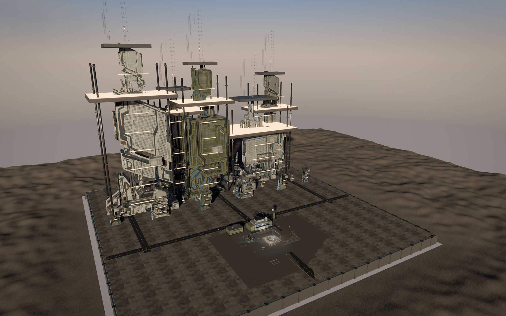

# Anvil Landing — authored city deck + Kitbash3D tiers

Private quality proof for the Anvil Landing port. The district sits on an authored,
flat **1200 × 1200 m city deck** with a 40 m retaining wall, panel seams, roads,
plaza and edge lighting. There is **no terrain under the deck**: a terrain ring
starts at the wall base and forms the rocky desert outside. All buildings are placed
on the deck at z = 0.

The Kitbash3D modules are used in three deliberate tiers so K039 is never asked to
carry a hero close-up:

| Tier | Contents | Scale / height | Distance from pad |
|---|---|---|---|
| **Hero port** | custom terminal, hangar door, warehouse, control tower, 56 m gantry, tanks, pipes, lights, A-30, crew | **1:1** — terminal 34 m, gantry 30 m, ship 25 m, pad 60 m, humans 1.86 m | 0–140 m |
| **Midground** | K039 G/H/I/J + C/D, dressed with K014/K034 greebles, window bands, pipes, roof plant | **4–5×** — G 140.6 m, H 114.0 m, I 85.5 m, J 80.6 m | 400–450 m |
| **Background** | 16–25× K039 LG modules, single or 2-stage, with structural collars, service spines and greeble bands | **475–809 m** with spires | 650–740 m |


*01_wide_port — hero terminal, A-30 on TLOF-01, gantry and midground K039 towers.*


*02_pad_closeup — port detail and ship, custom terminal rather than a K039 wall.*


*03_elevated_city — authored platform, deck edge, retaining wall, mega-tower skyline and terrain ring.*

## City deck

- Deck: **1200 × 1200 m**, chamfered, top at apron elevation, 16 m slab, 40 m
  retaining wall with 60 m-spaced buttresses, parapet and edge lights.
- Surface: 40 m panel joints, plaza around the port, painted deck labels, approach
  road, boulevard (y = 180 m) and three north avenues.
- Terrain: a 3.2 km ring mesh outside the deck only; deck hole has no terrain under
  it. Buildings: midground front 400 m, background centers 650–740 m; all footprints fit
  inside the 1200 × 1200 m deck, so nothing intersects terrain or overhangs the
  retaining wall.
- Port: 210 × 140 m apron, 60 × 60 m TLOF, A-30 25 m, custom 34 m terminal with a
  26 × 15 m hangar door, 20 m warehouse/loading dock, 62 m control tower, 30 m gantry,
  cryo tanks, pipe rack, containers, GPU, crew and apron lights.

## Scale evidence

The source FBX declares **UnitScaleFactor 0.1** (1 unit = 1 mm); BldgLG_G has raw
coordinates up to ~28,566 units. Blender applies a 0.001 import scale, giving
**28.57 m** at 1×. The 1× dimensions are G 15.9 × 8.6 × 28.1 m, H 13.0 × 6.6 × 25.3 m,
I 22.2 × 11.1 × 17.1 m, J 14.0 × 4.8 × 16.1 m. Kitbash3D's public human-scale
article confirms these are large industrial structures (~1.8 m people against the
façades), not 100 m towers.

The study images keep the A-30 at 25 m, the human at 1.86 m and the TLOF at 60 × 60 m:

- [`scale_study/study_1x.png`](scale_study/study_1x.png) — 28/25/17/16 m, reads as sheds
- [`scale_study/study_3x.png`](scale_study/study_3x.png) — 84/76/51/48 m, reads as towers
- [`scale_study/study_5x.png`](scale_study/study_5x.png) — 141/127/86/81 m, ship/pad become tiny
- [`scale_study/README.md`](scale_study/README.md) — unit evidence and decision

A uniform 10× (the earlier review build) scaled doors, windows and greebles, crowded
the pad and put low-detail K039 façades beside the camera. The final scene is
**not** a uniform scale-up: heroic foreground is 1:1 custom, midground K039 is 4–5×,
and only the distant skyline is 16–25×.

## Greeble dressing

`asset_audit_greebles.json` / `asset_audit_rooftops.json` document the extra packs:

- **K014 Greebles** — 30 meshes, 548,954 tris, 1–8 m vent/pipe/panel clusters.
- **K034 Props Rooftops** — 262 meshes, 909,500 tris; AC handlers, water towers,
  antennas, dishes, billboards, fire escapes, skylights, vents, gantries.
- 17 K014 and 29 K034 prototypes were imported, parent transforms cleared,
  normalized, assigned the scene's KB3D PBR materials, and re-used on the custom
  terminal, the midground lower 30–100 m, and at background joints/roofs.
- Modelshop Greebles is only partially downloaded locally and was not needed.

## Real-time kit

`glb/anvil_landing_port.glb` — **44.17 MB / 2,893,888 tris / 35 materials**
(Three.js count), 44 WebP texture maps, 5 meshes. Under the 50 MB limit.

- Compression: `EXT_meshopt_compression`, `EXT_texture_webp`,
  `KHR_mesh_quantization`; textures capped at 1K.
- Groups: RT_Ground 114k, RT_City 2.376M, RT_Port 354k, RT_Ship 42k,
  RT_People 8k (raw export stats; optimizer joins primitives).
- Decimation: midground G/H 0.10, I/J 0.15; background MEGA 0.50 (already decimated
  at build); greebles 0.25; port 0.45; gantry 0.45; ship 0.85; deck/terrain 0.8/0.45.
- The Blender renders use full-resolution geometry and 4K Kitbash3D maps; the GLB
  is a separate web build.

## Preview

`preview/index.html` is self-contained (vendored Three.js r187, MeshoptDecoder,
postprocessing); no CDN.

```bash
cd docs/kitbash-port
python3 -m http.server 8765
# http://localhost:8765/preview/
```

Preview screenshots: [`preview/preview_web.png`](preview/preview_web.png) (wide),
[`preview/preview_web_pad.png`](preview/preview_web_pad.png) (pad),
[`preview/preview_web_aerial.png`](preview/preview_web_aerial.png) (aerial).

## Reproduce

Prerequisites: Blender 5.3, Python 3 + Pillow/Numpy; purchased assets at
`/tmp/kb3d_fbx/asset_1.fbx`, `/tmp/kb3d_tex/Textures`, the extracted K014
`/tmp/kb3d_greebles` and K034 `/tmp/kb3d_rooftops`; and
`public/models/thunderbolt.glb`.

```bash
python3 scripts/kitbash/gen_textures.py
/Applications/Blender.app/Contents/MacOS/Blender -b -P scripts/kitbash/build_scene.py
/Applications/Blender.app/Contents/MacOS/Blender -b -P scripts/kitbash/render.py -- --final
python3 scripts/kitbash/grade_renders.py       # reads renders/raw, writes renders/
python3 scripts/kitbash/make_rt_textures.py
/Applications/Blender.app/Contents/MacOS/Blender -b -P scripts/kitbash/export_glb.py
cd docs/kitbash-port/glb
/Users/apple/orca/projects/verlins_home/node_modules/.bin/gltf-transform optimize \
  anvil_landing_port_raw.glb anvil_landing_port.glb \
  --compress meshopt --texture-compress webp --simplify false --palette false \
  --join true --instance false --texture-size 1024
```

`build_scene.py` calls `build_deck.py`, `build_terminal.py`, `build_greebles.py`
and `build_tiers.py`. The 753 MB full `.blend` is kept locally at
`docs/kitbash-port/anvil_landing.blend` but is not committed (git-ignored);
the scripts rebuild it. `renders/raw/` is also git-ignored.

## Limitations

- K039 is a midground/background kit here. Its façades are not hero close-up
  material; the custom terminal, gantry and deck carry the near field. K039 does not
  appear closer than 400 m.
- Background mega-towers are 16–25× K039 LG stacks; their large roof plates/overhangs
  read as megastructure silhouettes, not finely resolved skyscrapers. This is
  intentional for the 650–740 m distance.
- The deck is 1.2 × 1.2 km (within the requested 1.2 × 1.2 / 1.0 × 0.9 range). The
  809 m background tops crop in the wide/close-up; the aerial shows the platform
  and full depth.
- GLB glass is opaque reflective; Blender uses transmission. GLB textures are 1K to
  meet the 50 MB limit.
- The 1× source interpretation is physically correct; the 4–5×/16–25× tiers are an
  art-direction decision, documented above.
- The v2 `/terrain-sample/` route is a heightmap-only terrain demo
  (`src/scripts/terrain-sample.ts`); it contains no K039 buildings, so the port scale
  issue does not apply there.

Purchased Kitbash3D / A-30 assets; private sample, not merged to main.
